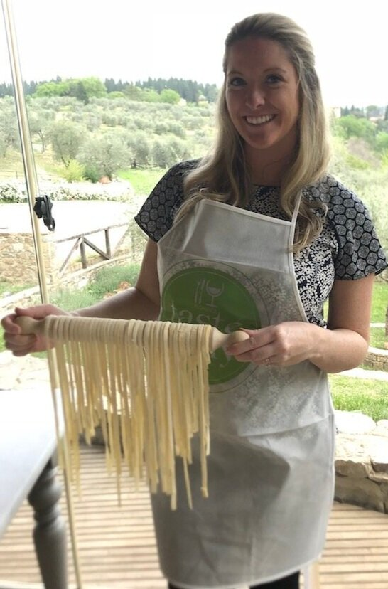

# rustic cooking with extra love

### I’m a one pot kinda gal…

Welcome to **one pot gal**, a blog by me, Kathleen. I love to cook, I love to host, and I LOVE an easy one pot meal to bring together family and friends. I’m a full-time working mom (previously NYC based but new to the burbs in Jersey!) and a wife to the love of my life Steve, who encouraged me to start this blog. Entertaining has always been my favorite thing to do. There is nothing better than gathering family and friends and filling wine glasses, talking and laughing over a cheeseboard, and making everyone feel comfortable, happy, and well fed. :) To me, the coziest homes are the ones with a bustling kitchen, a revolving door of houseguests, plenty of throw blankets and areas to cozy up, and of course -- comforting, approachable, delicious food.

So please enjoy one pot gal, where I will be posting lots of recipes and I’m sure an obnoxious amount of pictures of my baby boy aka light of my life, Sammy! Boop!

[@onepotgal](https://www.instagram.com/onepotgal) on Instagram

