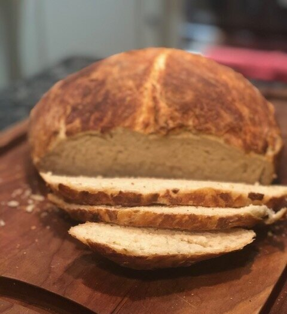
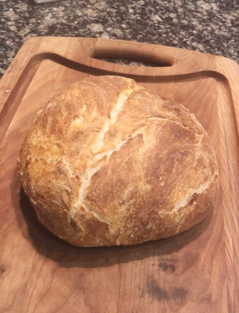
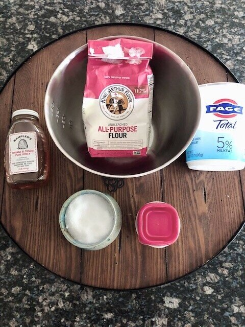
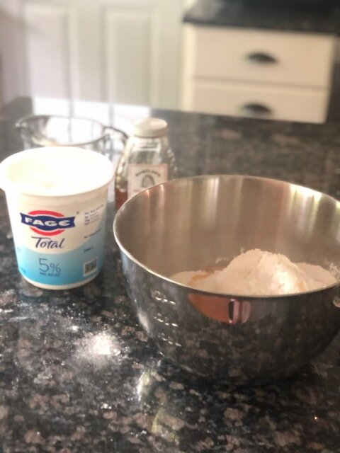
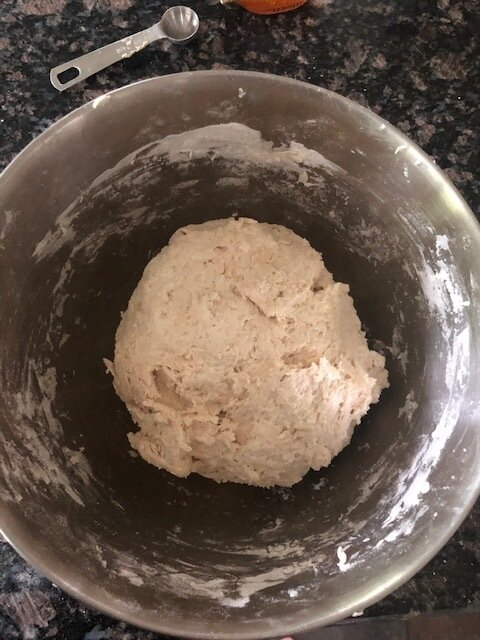
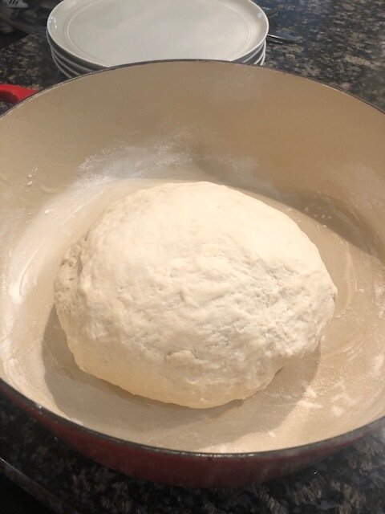
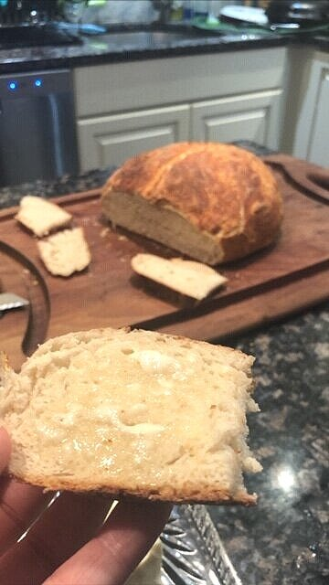

# 5 Ingredient Dutch Oven Sourdough Bread

I need to shout from a rooftop how AMAZING this sourdough bread is. It’s so perfect that I feel like I’m cheating, or someone is playing a trick on me. It doesn’t require any kneading or special mixers (I legit used my hands), it’s only 5 ingredients, and it’s SO. SO good.

Every time I make it, I convince myself that the previous loaf was just a fluke and there’s no way I make a perfect loaf of sourdough a second time. But then I DO! I do, I do!

It’s soft, the OPPOSITE of dry (#dontsaymoist...but #MOIST), with the perfect crust.

This is a [Half Baked Harvest](https://www.halfbakedharvest.com/cheaters-no-knead-dutch-oven-sourdough-bread/) recipe, so I cannot take credit for this magical specimen. Serve it with butter and eat it warm out of the oven and you will be in actual heaven.

*Probably shoulda picked a different color cutting board. #camoflaugealert*

*5 ingredients. You can use instant yeast or regular yeast - both work.*

One thing to note: I live on the east coast, so my baking times are different than instructed on Half Baked Harvest’s site. I’m not sure if the altitude affects this (she’s in the mountains of Colorado), or if it’s just the varying types of ovens. Her cooking times are longer - I have had the perfect loaf, time and again, with less time in the oven. So if you’re a coastie like me, follow my recipe/timing below. And when in doubt, just keep an eye on it. You’ll know it’s done when it has a golden brown crust!

*How the dough looks when you first stir it all together. It' should be sticky.*

*Not winning any awards with this photo, but you get the idea. Cover dough with a wet kitchen towel for 2 hours.*

*How the dough looks after 2 hours. Also - your dutch oven should be lined with parchment paper. I forgot to take a picture of that step!*

I’ve used instant yeast for this and regular yeast and both times the bread turned out great, so use whichever you have.

This bakes right in your Dutch Oven which is so convenient and so easy! Let me know what you think of this recipe in the comments. Enjoy!

### **RECIPE | 5 INGREDIENT DUTCH OVEN SOURDOUGH**

### **Ingredients:**

- 1 1/2 cups warm water

- 2 teaspoons yeast (I’ve used regular or instant - whichever you have)

- 1 tablespoon honey

- 5 cups all-purpose flour

- 1 tablespoon kosher salt

- 1 cup plain greek yogurt (any % will work)

- Dutch oven for baking (4 qt or larger)

### **Instructions:**

1. Add the yeast to the warm water and stir until incorporated.

2. In a large mixing bowl, add the flour, salt, yogurt, honey, and water/yeast.

3. Mix the dough with a wooden spoon (or your hands) - until the flour is completely incorporated. Don’t overmix.

4. Cover the bowl with a wet kitchen towel (or plastic wrap) and let sit for 2 hours at room temperature until it doubles in size.

5. Dust a surface area with flour. Grab the dough (it will be sticky) and form into a ball.

6. Line your dutch oven with parchment paper and add the dough to the center of the pot. Let sit for 1 hour or until it doubles in size.

7. Preheat oven to 475 degrees. With the lid on, bake for 20 minutes. Then, remove the lid, and cook for another 18-22 minutes. (oven temperatures can vary, so check on it after 15 minutes. You’ll know it’s done when the crust is golden brown.)

8. Remove from the oven and carefully lift the bread out of the dutch oven with the parchment paper. Allow the bread to rest for at least 30 minutes and up to 2 hours (it continues to cook while it sits).

9. Slice, slather with butter, and ENJOY!

*#isbutteracarb?*
