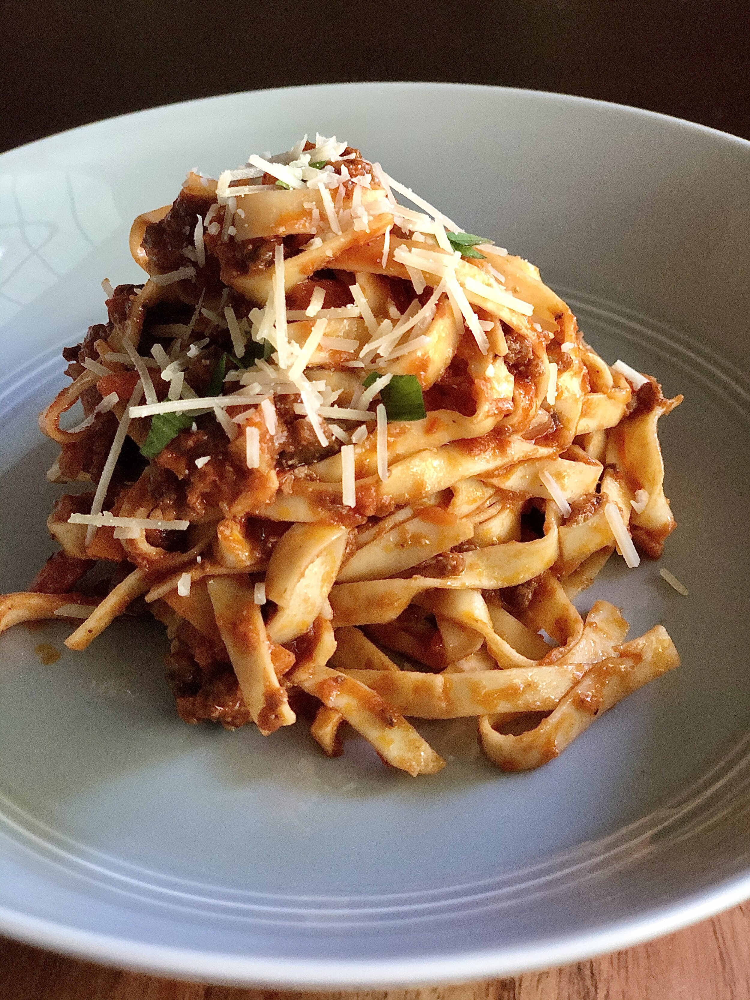
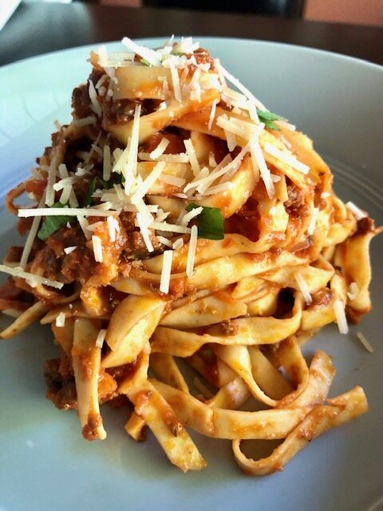
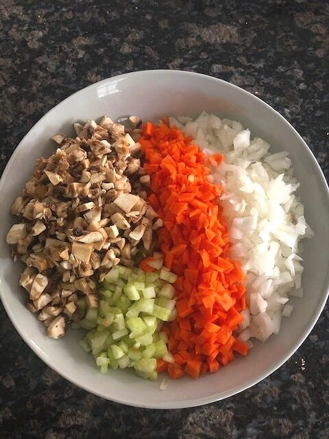
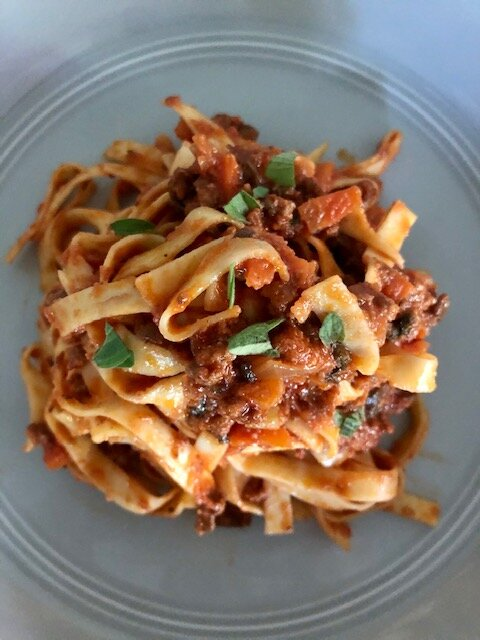

# Homemade Bolognese

The first time I made this bolognese, my husband and I hovered over the pot eating it by the spoonful and we both exclaimed that it was so good, it didn’t even need pasta. I stand by this statement today. (However…you mayyyy as well have it over pasta. Preferably with a tagliatelle, bucatini, pappardelle, or spaghetti).

The secret weapon in this sauce is the addition of spicy Italian sausage. If you don’t like spicy, don’t fret—it’s a small amount, and adds just the right amount of salty, porky, umami flavor—without finishing “spicy.”

*hello, beautiful.*

The sauce is chunky, as it should be—with finely diced onion, carrot, celery, garlic, and mushroom. You have all the right players in the pot: red wine, tomatoes, beef, pork, veggies, broth, and herbs. Let it simmer for 2 hours and finish off with cream and parmesan cheese, and—*chefs kiss*

*Beauteous rainbow: mushroom, celery, carrot, onion.*

Highly recommend this recipe. Preferably with a hunk of bread for dipping, and a glass of red wine. Enjoy!

**RECIPE | HOMEMADE BOLOGNESE**

**Ingredients:**

- 12 ounces pasta of choice (I like spaghetti, bucatini, tagliatelle, fettuccine, or pappardelle - it needs a long noodle!)

- 1 small yellow onion, finely minced

- 2 celery stalks, finely minced

- 1 large carrot, finely minced

- 1 cup finely diced mushrooms (button or baby bella)

- 3 fat cloves garlic, finely minced

- 2 hot Italian sausage links, casings removed

- 1.5 lbs ground beef

- 1 tablespoon tomato paste

- 3 tablespoons butter

- 1/2 cup red wine

- 1/4 cup beef or chicken broth

- 28 ounce can San Marzano crushed tomatoes

- ½ cup fresh grated pecorino romano cheese (or parmesan works too) - plus more for serving

- 1/3 cup half and half (eyeball, to taste)

- 2 bay leaves

- Splash of Worcestershire sauce

- 1 teaspoon dried thyme (or if using fresh, a couple of large sprigs)

- Handful of fresh basil (if you have it)

- Salt and pepper to taste

**Instructions:**

1. In a heavy skillet or dutch oven, saute the sausage in olive oil at medium/medium-high heat and brown it while breaking it up with a wooden spoon or spatula. You want it finely ground.

2. Add the ground beef and continue to brown. You want it to crackle and pop a bit until the meat gets browned and the excess fat is dissolved. If there seems like a lot of liquid, turn up the heat and keep sizzling until it reduces/caramelizes.

3. Remove the meat and set aside.

4. To the same pan, add the onions, celery, carrot, mushroom, garlic, bay leaf, and thyme. Saute at medium heat for ~5-10 minutes or until the vegetables start to soften, being careful not to burn the garlic.

5. Clear a space in the middle of the pan and add the tomato paste and 1 tablespoon butter. Let it melt and cook down a bit, then stir it into the veggies.

6. Add the wine, stir, and let reduce for a couple minutes.

7. Add the beef and sausage back to the pan.

8. Add the broth, tomatoes, Worcestershire, salt, and pepper, and let the sauce simmer at medium-low for 1.5-2 hours - checking and stirring it often. You want a low bubble, not a boil.

9. Remove the bay leaves and add the finishing touches: the butter, half and half, and cheese. Stir, making sure the cheese is fully melted into the sauce.

10. Adjust for salt and pepper. Add fresh basil, if using.

11. Serve over pasta (cooked al dente) with more cheese and fresh basil for topping bowls.

12. Enjoy!
