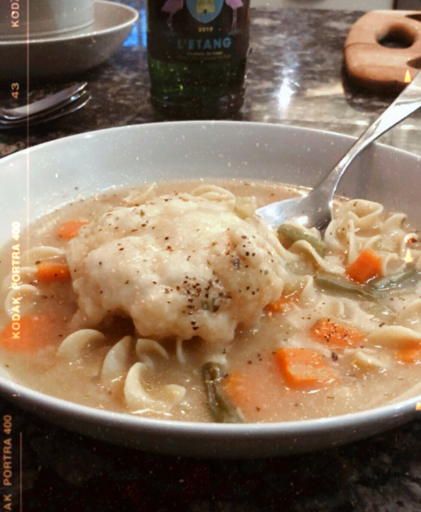
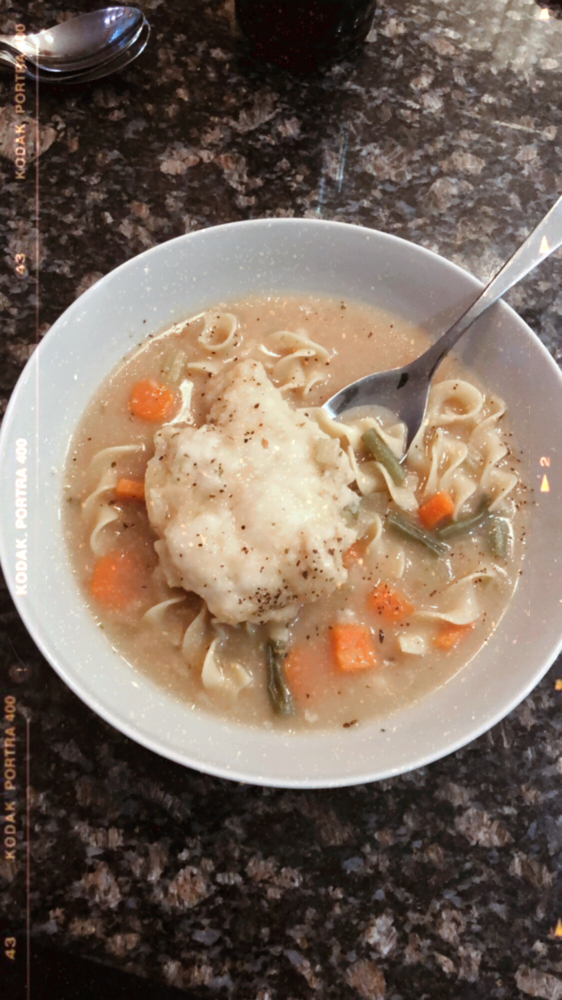

# Chicken and Dumpling Soup

This is my mom’s recipe and I wouldn’t change a thing about it. It starts out as your basic chicken noodle soup, but then magic happens when you mix up the most perfect dumpling batter, drop it by the spoonful into your broth - and then watch it fluff up into heavenly little pillows!

This soup reminds me of my childhood, but it also has some pretty great memories from my adult life too. Like snowy days in our NYC apartment that I miss so much! Special shout out to my friends Blake and Cuse who have requested this soup (and my lasagna) on many occasions, typically after a long day of day-drinking and bar hopping in midtown….to be followed by naps on our couch, and a cozy night in with wine and friends and all the chicken and dumpling soup our little hearts desired! (…that somehow went from wholesome to degenerate real quick lol).

But alas, the soup! It’s cozy, it’s noodly, it’s creamy, it’s homemade, and it’s one pot. And super easy to make.

So here is my one-pot recipe for chicken and dumpling soup.

(Also: I know it’s springtime and this is for sure a cold-weather meal….BUT, it’s been rainy and chilly and gross here! And we’re quarantined. Sooooo let me live my life!)

Enjoy!

**RECIPE | CHICKEN & DUMPLING SOUP**

**Ingredients:**

**Dumplings:**

- 2 cups Betty Crocker Bisquick* (has to be Bisquick brand!)

- 2/3 cup whole milk

**if you don’t have Bisquick (because #quarantine) see alternative option below. ***
Soup:**

- 2 quarts chicken broth (store bought or homemade)

- 2 carrots, peeled and diced

- 1/2 of a yellow onion, diced

- 2 celery stalks, diced

- 1 cup fresh green beans, chopped into 1 inch pieces (optional - I only use if I happen to have)

- 1 bay leaf

- 2 boneless skinless chicken breasts (or, you can use leftover turkey or even a rotisserie chicken)

- Salt and pepper

- Egg noodles (Pennsylvania dutch extra wide are best); use about ⅓ of the bag

- Thyme: 2 whole sprigs if using fresh; 1 teaspoon if using dried.

- 1 teaspoon dried parsley

**Instructions:**

- In a large pot or dutch oven, sauté the onion, carrot, and celery with olive oil over medium heat. Add the thyme, parsley, and bay leaf. Sautee until the vegetables start to soften, about 3-5 minutes.

- Add the 2 quarts of broth and the chicken breasts and bring to a low but steady boil. Cook until the chicken is cooked through, about 10-12 minutes. Remove, shred or chop, and return to the pot.

- Make the dumplings: In a large mixing bowl, add the Bisquick mix and milk. Stir until evenly incorporated - it should be a sticky dough. Do not overstir. It’s okay if there are lumps!

- Add green beans to the soup, if using.

- Bring the soup to a rolling boil and drop the dumpling mix by heaping spoonfuls into the soup. They will drop, then float. Use all of the dough. This should make about 8 dumplings depending on how big your spoonfuls are.

- Set a timer: Turn heat to medium low and cook for 10 minutes, uncovered. Treat this like baking - it has to be exactly 10 minutes.

- Once 10 minutes has passed, make an opening between the dumplings with a spoon and carefully add the egg noodles.

- Add a generous amount of salt and cracked pepper to the dumplings.

- Set a second timer: 10 more minutes, but with the lid on this time. No peeking! The dough will rise and make perfect fluffy dumplings.

- After 10 minutes, remove the lid. Test the dumplings with a fork - they should have risen to cover the whole surface area of the pot - and should be fluffy and dry on the inside.

- Turn off the heat and serve! Sprinkle bowls with fresh parsley if you have it.

*
No Bisquick? No problem! Substitute recipe below:*

*Ingredients:*

- *1 1/2 cups all-purpose flour *

- *2 teaspoons baking powder *

- *1/2 teaspoon salt*

- *3 tablespoons cold butter *

- *3/4 cup whole milk *

*Instructions:*

- *Add dry ingredients together in a mixing bowl. *

- *Add the cold butter to the mixture and with two knives “cut it in” (aka literally cut the butter into the dry mix for 3-5 minutes until all the butter pieces are pea sized).*

- *Add the whole milk. Don’t over stir - just combine to make a dough. *

- *Continue with above recipe and drop dough into soup. *
