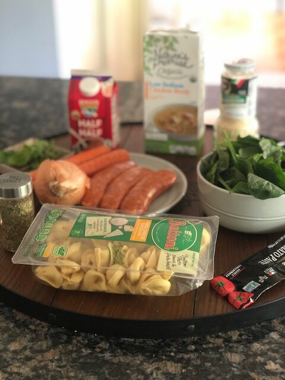
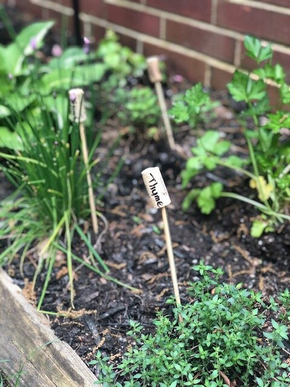
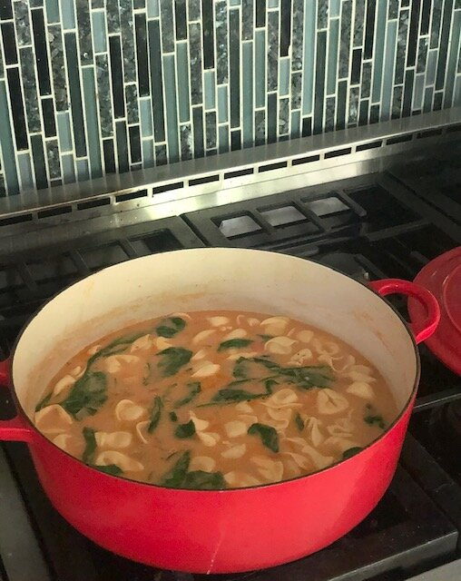
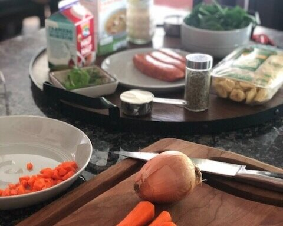

# Creamy, Dreamy, Tortellini Soup

I have ZERO business making this soup in the middle of May. This soup is what Fall and Winter dreams are made of. It’s warm and cozy and begging you to snuggle up on the couch with a blanket, a good book, and a hunk of bread to mop up the broth.

However. We are stuck indoors, it’s RAINING, the sky is ominous—and I decided this is acceptable to eat as a spring/summer storm kind of meal when you need something cozy and comforting.

This recipe is really easy, comes together in one pot, and you should have most of these ingredients in your pantry/fridge.

It starts with the basic trinity of any soup: carrot, celery, and onion. I was out of celery, so had to skip it, but typically you would use celery for this. I also used fresh herbs from the garden.

*Ingredient checklist*

*Herb garden: I used fresh basil and oregano in this recipe! But you can use dried if that’s all you have.*

Don’t be scared of hot Italian sausage. It gives the soup the right kick - without being overly spicy. I would argue regular sweet Italian sausage wouldn’t work as well, but if that’s all you have, go for it — but maybe throw in a pinch of red pepper flakes for good measure.

You can also make this vegetarian and skip the meat entirely and sub veggie broth instead of chicken broth.
Give this recipe a try and let me know what you think! I am also posting the BEST sourdough bread recipe, which I highly recommend making as an accompaniment to this soup. Enjoy!

**RECIPE | CREAMY, DREAMY TORTELLINI SOUP**

**Ingredients:**

- 3 links hot Italian sausage (casings removed)

- 2 carrots, diced

- 2 celery stalks, diced

- 1 small yellow onion, diced

- 2 tablespoons tomato paste

- 1/2 cup red wine

- 1/4 cup all purpose flour

- 1 bay leaf

- 20 oz. cheese tortellini (buy fresh pasta, from the refrigerated aisle)

- 2 cups baby spinach (loosely packed)

- 1.5 quarts chicken broth

- 1 cup half and half

- 3/4 cup grated Parmesan cheese, plus extra for serving

- 6-8 fresh basil leaves, torn (or about a teaspoon if using dried)

- 2 sprigs fresh oregano (or ½ teaspoon if using dried)

- Salt and pepper to taste

**Instructions:**

1. Crumble the sausage (using a little olive oil) in a sturdy soup pot. Cook through, breaking it all up with a spatula or wooden spoon.

2. Add the celery, carrot, and onion and saute at medium-low until they soften (about 7-10 minutes), being careful not to brown them. Add salt.

3. Create a space in the middle of the pot and add the tomato paste. Stir into the vegetables.

4. Add the red wine, and stir everything together. Cook for 1 minute.

5. Add the flour and stir quickly, using a whisk. Add a little broth if it’s too dry and keep whisking until the flour is completely absorbed.

6. Add the remaining broth + the oregano and bay leaf. Bring to a boil, stirring to ensure the roux (aka flour mixture) is evenly distributed throughout. Once it’s at a rolling boiling, bring down to a simmer (medium low).

7. Simmer for ~15 minutes. You want the veggies to cook through and the broth will also thicken a bit.

8. Add the tortellini, half and half, cheese, salt and pepper. Make sure there’s a light boil going.

9. Once tortellini are cooked through, add the spinach and fresh basil.

10. Serve with Parmesan cheese and a hunk of bread for mopping up the broth!

