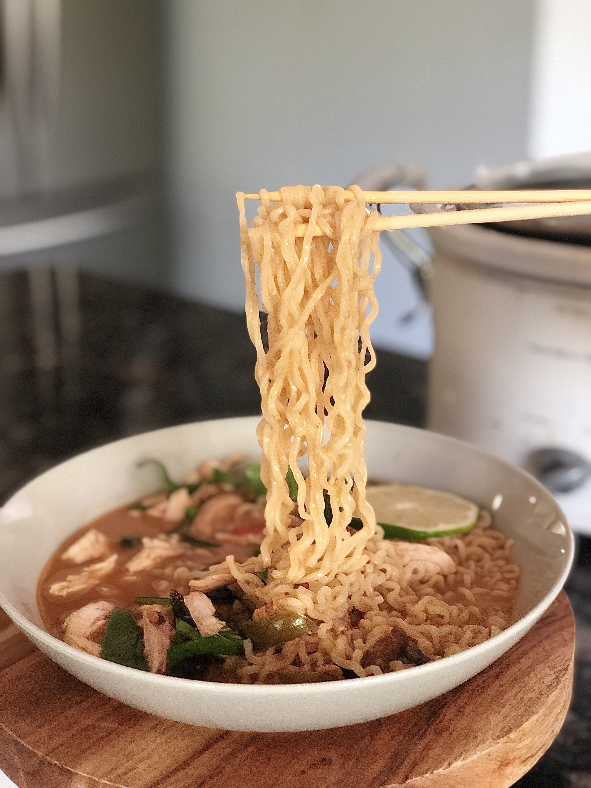
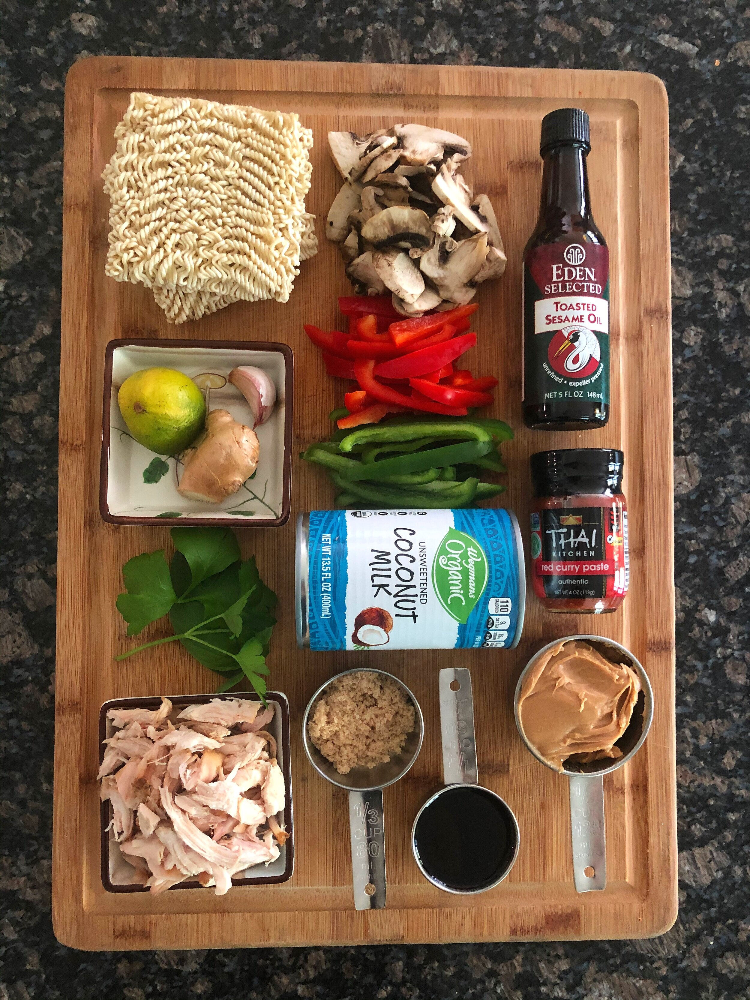
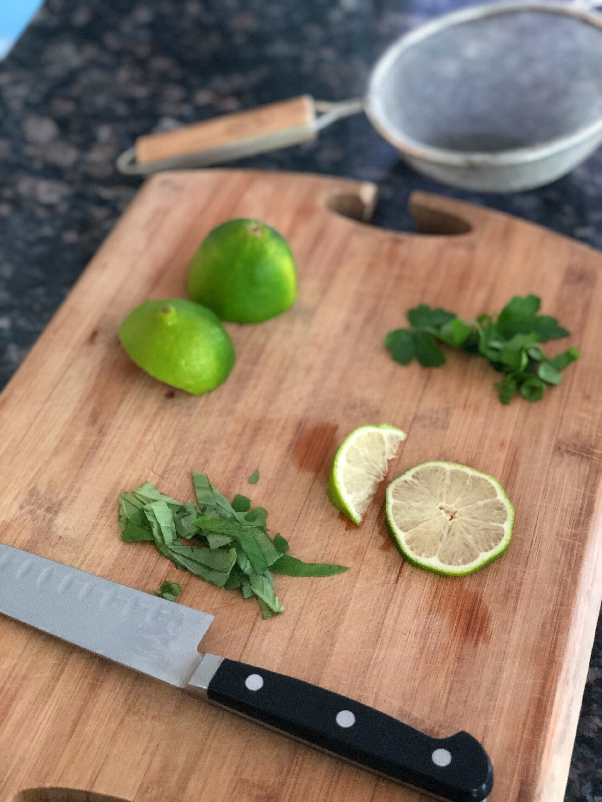
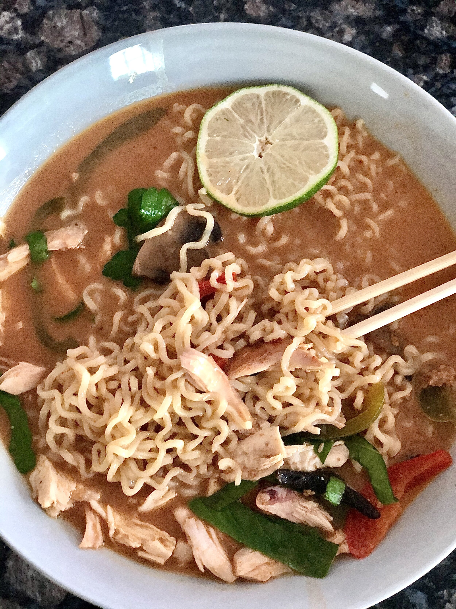

# Crock-pot Thai Chicken Ramen

Like any other 80s baby, I grew up eating Top Ramen. Then I moved to New York City and tried *actual* ramen. My favorite ramen restaurant in the city, hands down, is Ippudo on 4th and Lafayette.

But this post isn’t about dining out, because - WE STUCK IN. #Corona. So this is my “better than takeout” version of ramen that will satisfy your ramen cravings without having to leave the house.

This recipe is SO easy - everything is thrown into a crock-pot. Then you ladle the broth on top of your noodles and you’re DONE.

So two things: I had leftover chicken that I shredded and used for this, which is what you see in the photos. For your purposes, you would add the raw chicken breast directly to the crockpot.

I also didn’t have fish sauce so I substituted 1 tablespoon rice wine vinegar (white wine vinegar would work too) + 1 tablespoon soy sauce. If you have fish sauce though - use it. It adds great umami flavor to this dish (and no, it doesn’t make the broth taste fishy). I like the brand Red Boat - you can buy on [Amazon](https://www.amazon.com/Red-Boat-Premium-Fish-Sauce/dp/B00B617XK2).

This recipe is pretty versatile, so you can use what veggies and proteins you have on hand. Pork or beef would work great with this. Even shrimp! For veggies, I’ve made this with onions instead of mushroom. You could even add spinach to get some greens in. I love bok choy but assume that would be tough to get at the grocery store these days.

Oh, and if a poached egg is your thing - go for it! You’re the boss of you.
**
RECIPE | CROCK-POT THAI CHICKEN RAMEN**

**Ingredients:**

- 1 boneless skinless chicken breast

- 1 teaspoon ground ginger (or fresh)

- 1 clove garlic, minced

- 1 red pepper, thinly sliced

- 1 yellow or green pepper, thinly sliced

- 1 container button mushrooms, sliced (crimini work too)

- 1/4 cup thai red curry paste

- 1/3 cup creamy peanut butter

- 1 quart chicken broth

- 1 can unsweetened coconut milk

- 1/4 cup reduced sodium soy sauce

- 2 tablespoons fish sauce (if you can’t find fish sauce, sub 1 tablespoon white wine vinegar or rice vinegar with 1 tablespoon soy sauce)

- 1 lime juiced, plus more wedges for serving

- 2 tablespoons brown sugar

- 1 teaspoon smoked paprika

- Couple dashes cayenne pepper

- Ramen noodles

- **Best option: **10 oz. box Nona Lim Toyko Ramen (found at [Whole Foods](https://products.wholefoodsmarket.com/product/nona-lim-tokyo-ramen-noodles-6818ee))

- **Second best option:** 10 oz. bag Lotus Foods Organic Millet & Brown Rice Ramen

- **When in quarantine **(and nothing to be shameful about!): Use [Top Ramen](https://www.amazon.com/Nissin-Top-Ramen-Chicken-24/dp/B006MBTC50) (the old school kind - 4 packets of them), but throw away the seasoning packets and just use the noodles.

- For topping bowls: (optional, use what you like) Chopped cilantro, chopped basil, mung bean sprouts, sriracha, thinly sliced jalapenos or hot pepper of choice, green onions, lime wedges, chopped peanuts, and (if you have it) chili oil or sesame oil for swirling on top.

**Instructions:**

- Add everything (except for the garnishes and noodles) to the crock-pot. Cook high for 3 hours. No peeking! (Every time you lift the lid, the temperature drops and you lose cooking time)

- Remove the chicken, shred it, and set aside for plating.

- Cook the ramen noodles according to the package instructions, being careful not to overcook. Strain.

- Time to build your bowls: Add the noodles to the bottom of your bowl first, then the chicken, then ladle the soup on top.

- Top with a squeeze of lime wedge, fresh herbs, and additional spices and toppings to your liking! The toppings are the best part, so do it up!

- Slurp!

Note: To store leftovers, keep the noodles separate from the broth, otherwise the noodles will absorb all the broth and turn to mush!

