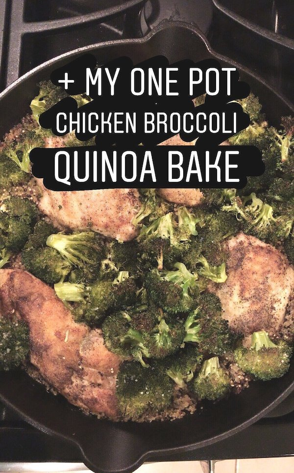
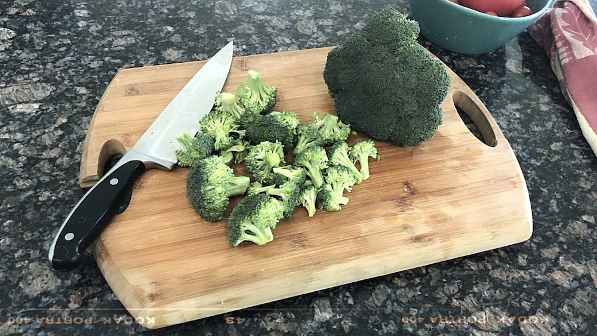
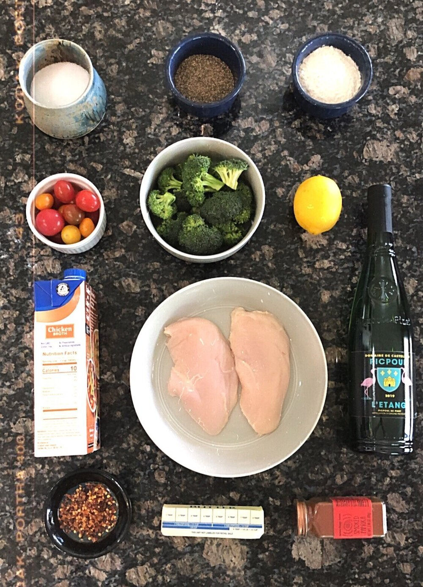
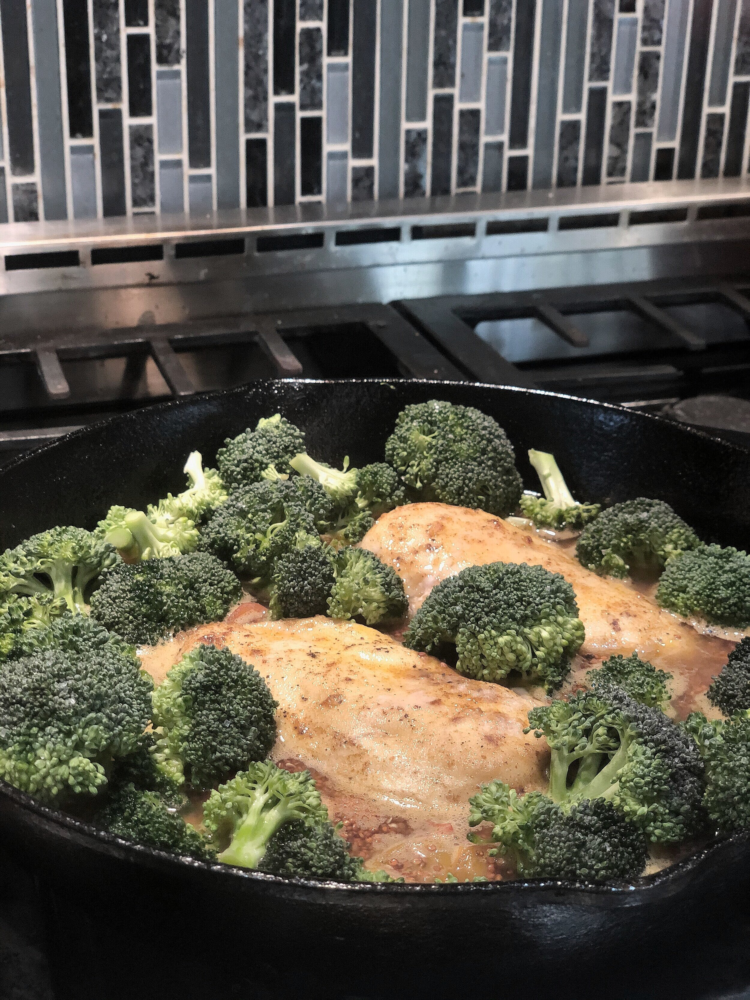
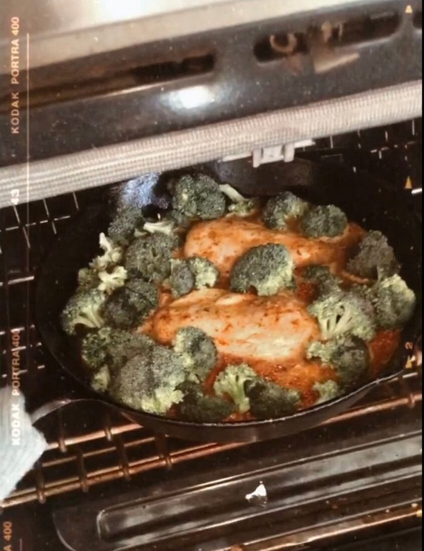
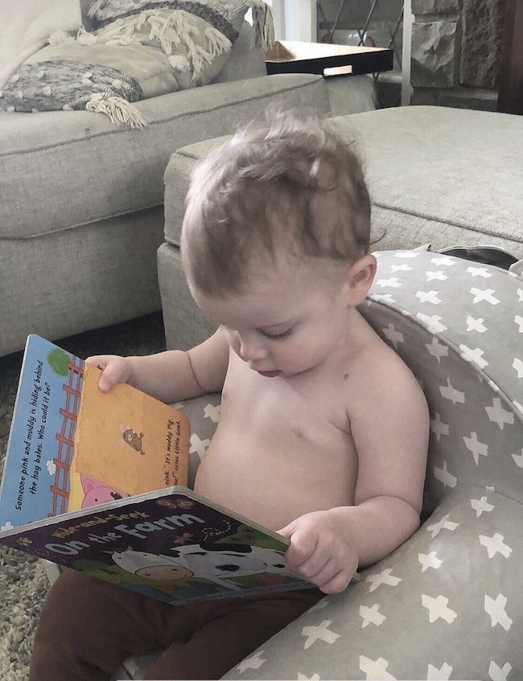
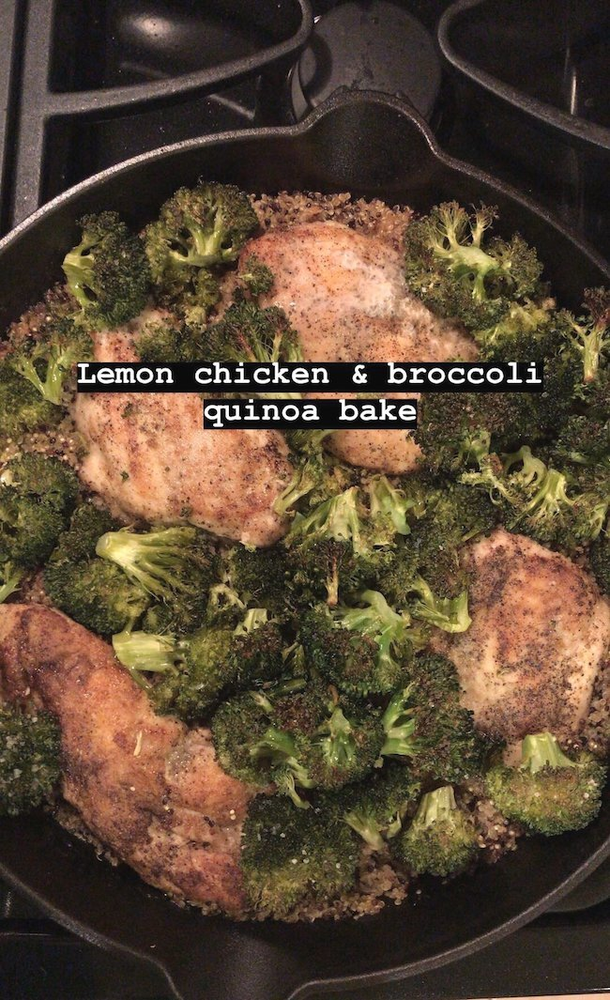

# One-Pot Chicken Broccoli Quinoa Bake

This recipe is a good transition out of the cold weather months because while it’s still hearty and satisfying - it’s a lightened up version of your typical chicken broccoli casserole.

I LOVE this recipe. It’s so easy, you cannot mess this up. AND it’s super versatile based on what you have in the fridge. I’ve made this with kale instead of broccoli. You could throw mushrooms in here. Or any herbs you have on hand (thyme, parsley, or rosemary would work). I love it because it’s a one-pot, easy clean-up kind of meal - and it’s a great, healthy weeknight dinner.

*gimme gimme*

The chicken is juicy and lemony. The broccoli is charred. The quinoa is light and fluffy with a little kick from the red pepper flakes and paprika, and super flavorful from soaking up all the white wine, chicken broth, and buttery goodness.

This recipe came together after a long day at work when I wanted a quick, easy, healthy dinner for the fam. This was…...too easy. And TOO GOOD! (My husband Steve had THIRDS if that’s any indication.)

*All the accoutrement (insert 40-year-old virgin voice). Not pictured: the quinoa. Not-supposed-to-be-pictured: cherry tomatoes (they’re not in the original recipe). Whoops.*

Disclaimer: Since we’re quarantined, I didn’t have all my typical ingredients. I normally use white quinoa (we only had red) and I try to use homemade broth if I have it on hand. I also only had 2 chicken breasts instead of 4 (which the recipe calls for). And you can go ahead and IGNORE those cherry tomatoes because they’re not even in the recipe (wow I’m really thriving as a blogger!). But alas, I just used what we had. And you should too!

Note: If you DO want to use tomatoes (aka, you don’t have any greens on hand) I would advise skipping the lemon, as you don’t want it to be too acidic.

*Never cook with a wine you wouldn’t drink!*

(Doo-de-daaa, pretend there are no cherry tomatoes in that video)

Back to my recipe.

Broccoli pro-tip: In order to get deliciously charred broccoli (the kind with crispy, semi-burnt edges) and to AVOID mushy broccoli - make sure the broccoli is completely DRY after you wash it. If it has water on it, it will steam instead of char in the oven. I make sure to pat it dry with a clean kitchen towel or paper towels before going into the oven.

*Into the oven to get toasty!*

*And now we wait!*

**RECIPE | ONE-POT CHICKEN & BROCCOLI QUINOA BAKE**

**Ingredients: **

- 4 boneless skinless chicken breasts

- Zest and juice of ½ lemon

- 2 tablespoons butter

- 1 cup uncooked quinoa (I use white quinoa)

- ½ cup of white wine

- 2 cups chicken broth

- Flour for dredging the chicken (you can use almond flour or omit entirely if you want it GF)

- Head of Broccoli, chopped with stems removed so it’s just the florets

- Salt and pepper to taste

- Couple dashes of paprika (optional)

- Pinch of red pepper flakes (optional)

- Salt and pepper to taste

**Instructions:**

- Heat oven to 350°.

- Generously salt and pepper both sides of the chicken, then dredge in flour until evenly coated. In heavy oven-safe skillet (I used a cast iron pan), brown chicken in olive oil at high heat until both sides are toasty brown/seared. Remove.

- If you don’t have a pan that can go from stove top to oven, use a regular saute pan for this part and then you can transfer everything into a baking dish before going into the oven.

- Pour the white wine into the pan and let it sizzle out, being sure to scrape up all the bits at the bottom of the pan. Cook out for at least 1 minute.

- Add butter, lemon, lemon zest, red pepper flakes, paprika, and chicken broth and bring to a boil.

- If using oven-safe cast iron:

- Add the uncooked quinoa directly to the pan, stir, and turn off the heat. Tuck the chicken breasts on top of the quinoa mixture (directly into the pan) and then surround the chicken with the broccoli. Try to keep the broccoli to the top and not submerged into the broth. You want them to char - not boil/steam in the liquid.

- If using a separate baking dish:

- Add the uncooked quinoa to the bottom of the baking dish. Carefully pour the broth mixture over top. Then layer the chicken and broccoli on top of that.

- Before going into the oven, drizzle olive oil and a little salt to just the broccoli florets. A little goes a long way and it will help them char.

- Squeeze a little more lemon over the chicken breasts.

- Bake at 350 for ~30 minutes (or as long as it takes for your quinoa to cook through) and then broil on high for 1-2 minutes at the very end until broccoli is charred. You know it’s done when the quinoa is light and fluffy and the liquid is absorbed.

*Enjoy!*
