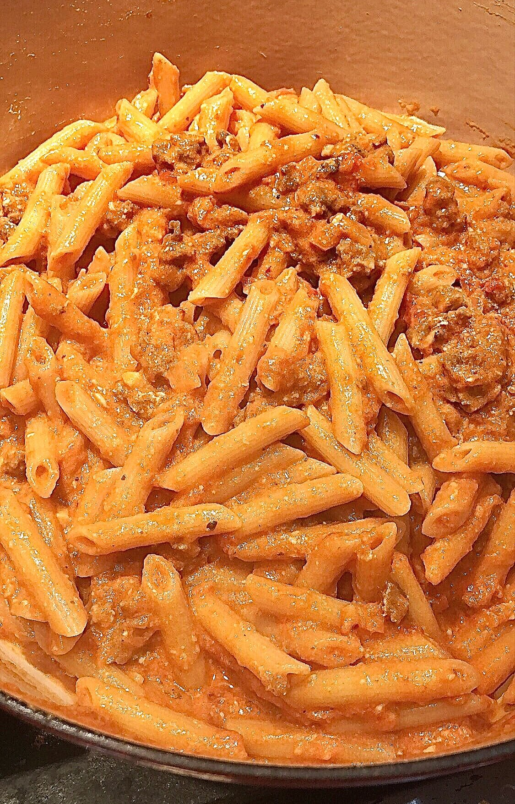
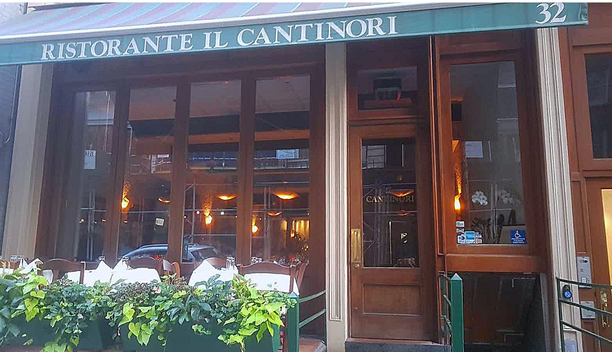
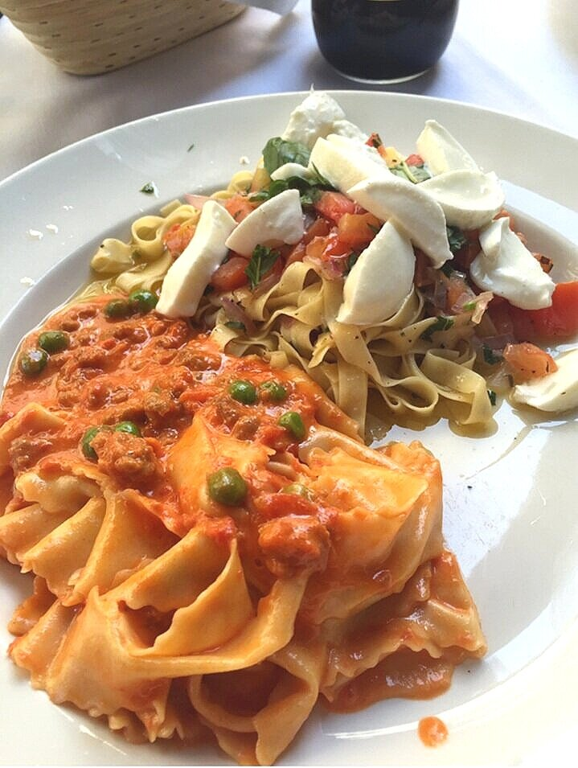
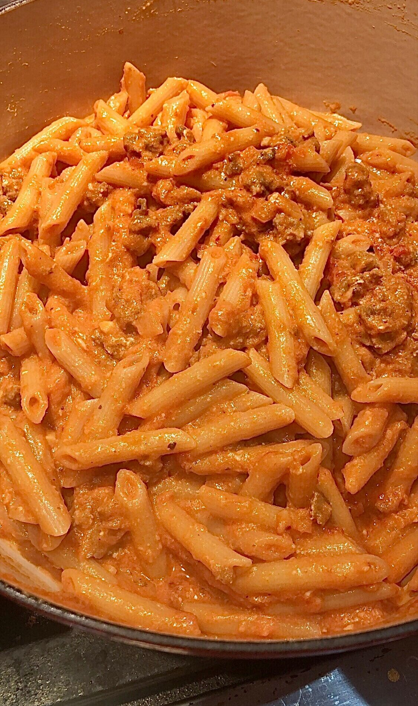
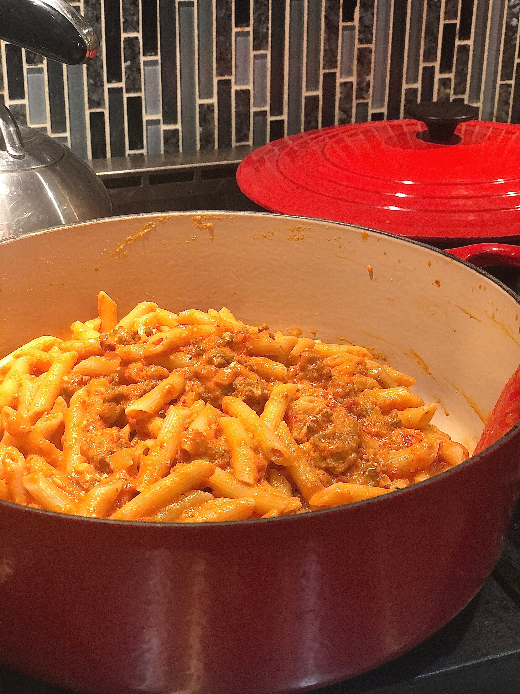

# Penne alla Vodka with Sausage & Peas

This pasta is an ode to my favorite pasta in all of New York City, the Pappardelle Alla Buttera from Il Cantanori on 10th Street and Broadway. Shoutout to Jackie Kwan, my work bestie aka boozy lunch buddy, who used to frequent this NYC quintessential Italian hole in the wall on many-a summer (work)days.

The restaurant sits on a quiet side street in NOHO. It always smells like magnolias and fresh flowers because there is an ELABORATE dangling bouquet above the bar. The tables are old school with white tablecloths. The servers knew us by name (or by our wine order). We'd sit outside on the outdoor patio for a lunch of laughs, venting, good wine, and the best pasta NYC has to offer.

*The best.*

A wee bit of history: Jackie and I met while bartending on the Upper East Side, but then we ended up side by side (literally, sat next to each other) as Executive Assistants at AOL.

#startedfromthebottomnowwealittlebitabovethebottom

I supported the CEO and Jackie supported the CPO. The work was hard, the hours were long, but the friendships made it all worth the ride. SO. When the menu would arrive we would AG. ON. IZE. Over what to order and we typically would always settle upon splitting TWO pastas (#fat). Sometimes we’d try the bucatini. Sometimes the bolognese. Sometimes the spaghetti amatriciana. But ALWAYS. ALWAYS, without question, we would order the pappardelle alla buttera.

Here is us bartending at the one and only famous Mad River (read: a sh*tshow of a bar on the upper east side, but easily some of the most fun nights of our twenties!). Actually this photo was taken in 2017 when we came back as guest “alumni” bartenders. Gotta show the young ones how it’s done, amiright?

*HI KEMI! HI PRE-BABY BODY!*

Okay, moving along to the pasta. At the restaurant, the noodles are homemade (which I’m not going to compete with) with the most delicious pink sauce, crumbled Italian sausage, and the freshest peas you ever did see.

The below recipe is inspired by this dish. Disclaimer: my recipe is a vodka sauce (a little different from the restaurant - wanted something that could stand up to a dried pasta), but the flavors are there.

Healthy, this is NOT. But it’s homemade and delicious and you gotta try it.

Second disclaimer: We were too busy INHALING this that I completely forgot to take a decent picture...whoops. #amatuerbloggeralert
I think that’s a good sign though? Give it a whirl and let me know what you think!

*Come to mama.*

*Sorry this photo is an abomination. Also, I had to omit the peas because my family HATES ME. (well, they hate peas).*

**RECIPE | PENNE ALLA VODKA WITH SAUSAGE & PEAS**

**Ingredients: **

- 1/4 cup good olive oil

- 4 links hot Italian sausage (you can sub with sweet Italian sausage, if you prefer, or use a combo)

- 1 Spanish onion, minced

- 3 cloves garlic, minced

- 1 teaspoon dried oregano

- Handful of fresh basil and fresh oregano, if you have it

- 1 cup vodka

- 2 28-ounce cans peeled plum tomatoes, drained from their juices

- Kosher salt

- Freshly ground black pepper

- 1 box penne rigate (rigatoni works too)

- 1 cup heavy cream

- 1 tablespoon butter

- 1/2 cup freshly grated Parmesan cheese, plus extra for serving

- 3/4 cup peas

**Instructions:**

1. In a large pot or sauté pan, melt the butter and brown the sausage, breaking it up with a wooden spoon or spatula so that it’s finely ground. Remove and put in the fridge.

2. To the same pan (keeping the sausage grease - don’t you dare wipe that away!) - add the olive oil, onion, garlic, and dried oregano. Cook at medium low, stirring and scraping up the bits from the bottom of the pan - until the onions are translucent (about 5 minutes). If the garlic starts browning, lower heat. This should sweat, not brown.

3. Add the vodka and simmer 5-7 minutes until mixture is reduced by half.

4. Drain the tomatoes and add them to the pan. If you have a potato masher, mash them directly in the pot. Otherwise you can crush them up with your hands before adding.

5. Lower the heat and cover your pot with a lid. Simmer for 1.5 hours, stirring occasionally and checking on it to make sure it’s not burning. It will get thick and jammy, so you have to keep an eye. You want this to reduce.

1. After 1.5 hours is up: Turn heat to your lowest possible setting.

2. Optional: For a smoother sauce - I like to puree it with an immersion hand blender right in the pot. Totally not necessary (it tastes just as good not pureed) but if you’re so inclined to take that extra step, I’m into it!

6. Bring a large pot of salted water to a boil and cook your pasta until it’s al dente.

7. Meanwhile, to the sauce: add the heavy cream, parmesan cheese, fresh basil, fresh oregano, and salt and pepper to taste. Add back the sausage and stir in the frozen peas.

8. Bring the sauce to warm, but you don’t want it boiling or the sauce could break.

9. When the pasta is done, drain really well. You don’t want any pasta water for this type of sauce, so shake off any excess. Then add the noodles directly to the pot.

10. Serve in big pasta bowls with extra parmesan cheese for topping - and pour yourself a glass of wine! You deserve it!
