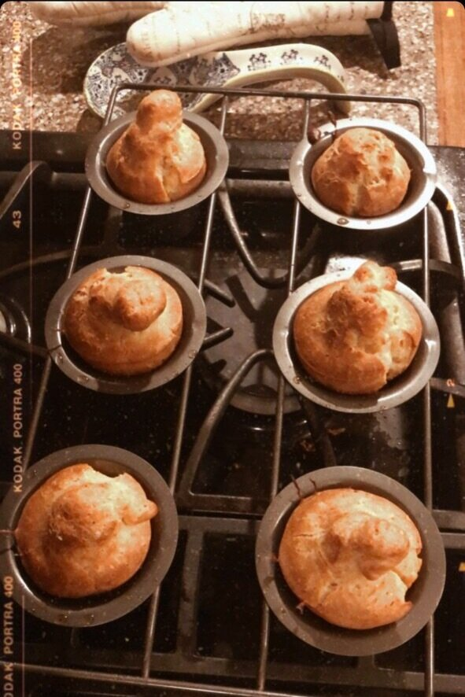
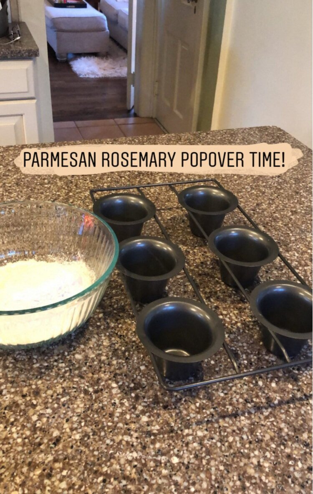
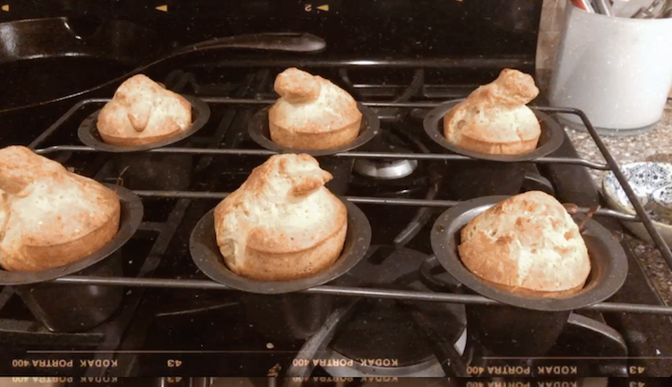
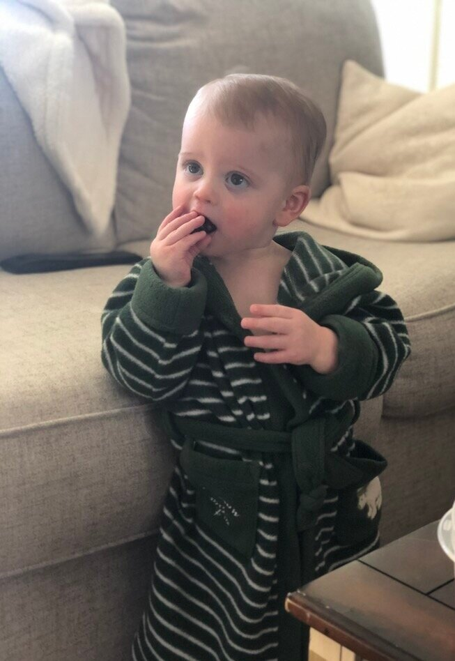

# Rosemary Parmesan Popovers

The first time I had popovers was at Davio’s, a steakhouse by Grand Central in New York City, where I lived for almost a decade. When I finally moved away from my beloved block of 44th and 2nd (insert crying face emoji) we missed a LOT of things about NYC, but #1 on our list was (and still is) the food. And these popovers.

If you’ve never had a popover, it’s like a tall savory baked bready siutation that looks like an exploding muffin. They’re hollow on the inside (when made correctly) with a buttery, eggy taste - and fluffy, flakey on the outside. Sometimes with a cheese or herbed crust. Always served warm, and always served with butter (or at least, should be!).

*Oh la la, what heavenly little nuggets.*

These Rosemary Parmesan Popovers are just what the quarantine gods ordered. There is nothing not to like. Browned butter. Rosemary. Garlic. Parmesan cheese. And the best part is that there is no yeast required!

The only tricky thing is that you *technically* need a popover pan. It’s like a muffin tin, but with deeper cups. BUT I took to Google and apparently a standard muffin tin will work as well. The shape will be a little different, but the flavor will still be there and they should puff up just the same.

After a few failed attempts (sorry Cassie Jacobson, who was one of my taste testers), I think I’ve finally mastered the perfect recipe! The KEY is 1) preheating your popover pan, 2) don’t over mix the batter, 3) make sure the milk and eggs are room temperature, and 4) use SALTED butter.

*My new popover baking pan - this recipes makes 6!*

*My favorite cozy nook. The perfect dreary day to bake and lounge around.*

*Fluffy buttery DREAMS!*

So here is my recipe for Rosemary Parmesan Popovers. Go get your quarantine bake on!

**RECIPE | ROSEMARY PARMESAN POPOVERS**

**Ingredients:**

- 1 1/2 cups all-purpose flour

- 1 1/2 cups whole milk, at room temperature

- 3 large eggs, at room temperature

- 2 tablespoons freshly grated parmesan cheese

- 1 teaspoon kosher salt

- 1 fat clove of garlic, smashed

- 1/2 teaspoon black pepper (fresh cracked is best)

- 3 leafy whole sprigs fresh rosemary, roughly chopped (if you don’t have fresh, you can skip the Rosemary or sub 2 tablespoons of dried)

- 2 tablespoons salted butter (for the batter)

- 6 teaspoons salted butter (for greasing the popover pan)

### **Instructions:**

1. Preheat the oven to 450 degrees.

2. Heat the 2 tablespoons of butter in a small skillet at medium heat. Add the garlic and rosemary and cook until butter has browned and the rosemary is fragrant (~4 minutes). Discard the rosemary and garlic, reserving just the infused browned butter. (You can use a fine mesh strainer or just carefully remove without wasting any of the butter!)

3. Pre-heat your popover pan (I use the standard 6-cup pan) by placing in the lower third of the oven at 450 degrees.

4. In a medium bowl, whisk together the room temperature milk and eggs until frothy for about 1 minute. Add the flour, browned butter, salt, pepper, and parmesan and carefully combine without over mixing. It’s okay if there are lumps.

5. Remove the heated popover pan from the oven and add a teaspoon of butter to each cup - swirl and let it melt, so that the butter coats all the sides. Then add your batter - filling up to about ¾ of the way per cup. (Note: depending on the size of your popover pan, this may make more than 6 popovers. Rule of thumb is don’t overfill your cups: stick to 3/4 filling.)

6. Transfer to the oven and bake for 20 minutes. Then, lower the oven to 350 degrees and bake another 10-15 minutes or until puffed up and golden.

7. Serve right away, warm - with butter!

*Toddler tested. Toddler approved!*
