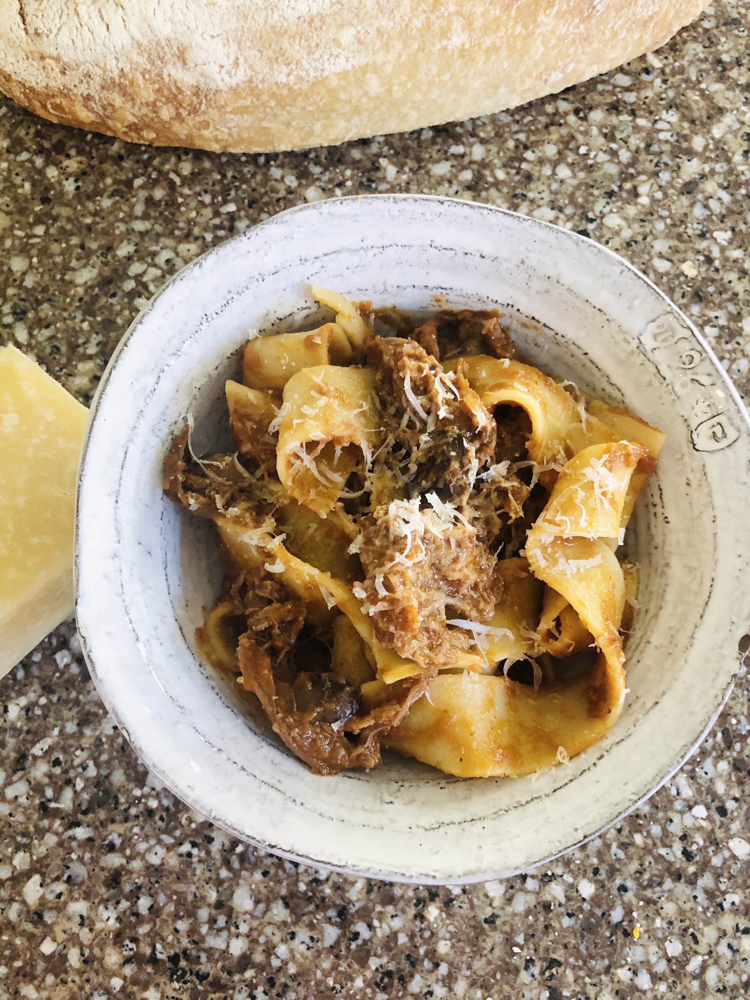
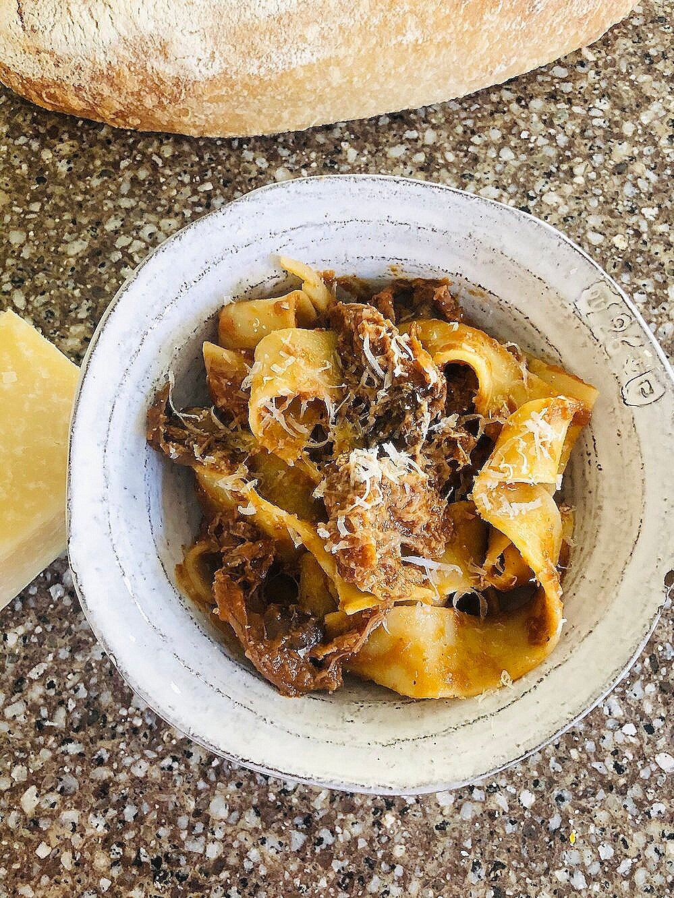
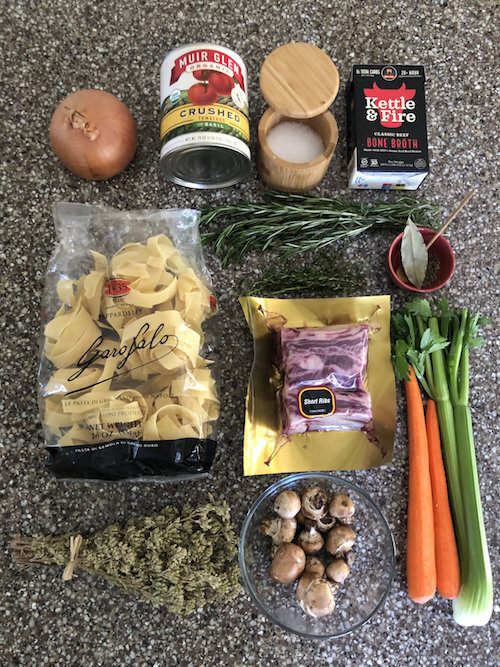
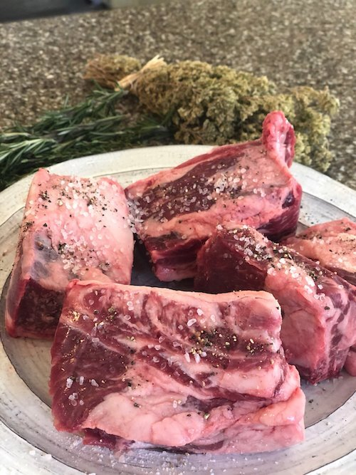
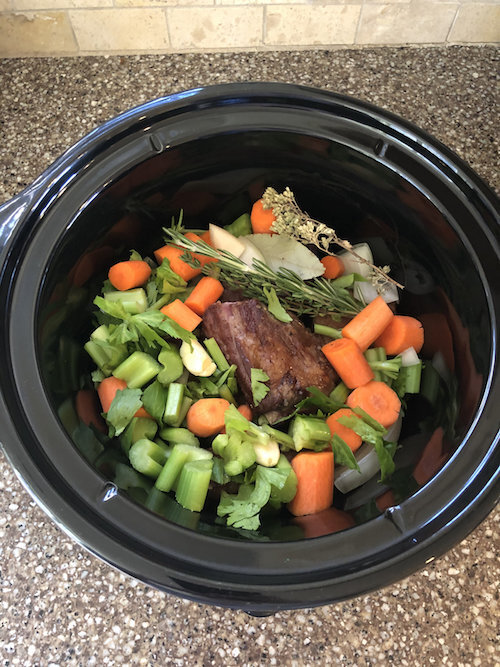
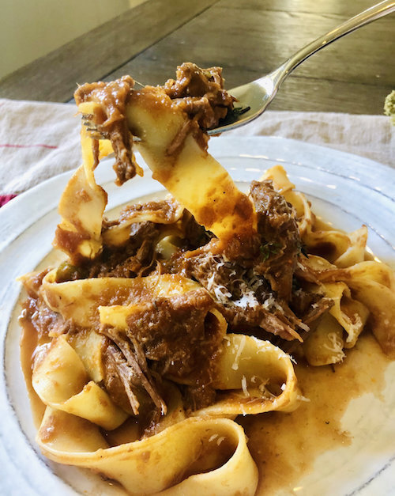

# Short Rib Mushroom Ragu

There is nothing not to love about this pasta. Red wine braised, fall-off-the-bone beef short ribs, a rich flavorful sauce that simmers all day with thyme, rosemary, and oregano — all served over twirly pappardelle pasta. It’s warm, cozy and comforting, but also decadent enough to impress your party guests! Serve with freshly grated parmesan cheese, crusty bread, and a good red wine.

*Short rib mushroom ragu over pappardelle pasta*

*Not pictured (whoops!): Garlic, red wine, Worchestershire sauce, and butter*

**RECIPE | SHORT RIB MUSHROOM RAGU**

**Ingredients:**

- 4lbs short rib on the bone

- Bacon fat or olive oil

- Salt and pepper

- 2 carrots, peeled and coarsely chopped

- 1 small yellow onion, coarsely chopped

- 2 celery stalks, coarsely chopped

- 2 sprigs fresh thyme (or 2 tsp dried)

- 1 sprig fresh rosemary (or 1 tsp dried)

- 1 sprig fresh oregano (or 1 tsp dried)

- 1 bay leaf

- 1 cup red wine

- 4 tablespoons butter

- 1 tablespoon Worcestershire sauce

- 1 container baby bella mushrooms, rinsed and sliced

- 1 quart beef broth

- 1 28 oz can San Marzano crush tomatoes

- Flour for coating the short ribs

- Good quality parmesan cheese (grate it yourself, it’s better that way!)

- Pappardelle pasta (or any noodle of your choice, I think this goes nicely with an egg noodle, a pappardelle, bucatini, or a fettuccine would work)

**Instructions:**

1. Generously season the short ribs with salt and pepper. Add flour to a shallow bowl or plate, and lightly coat the short ribs in flour, making sure each side is covered.

2. In a heavy skillet (I use cast iron) bring the pan to high heat. If you have bacon, throw a couple pieces on and use the grease to sear your ribs. If not, use a good quality olive oil.

3. Sear the ribs on all sides until browned with a crust. It will take a few minutes per side - use tongs to help get a 360 degree sear on all sides.

4. Add the meat, red wine, onion, carrot, celery, garlic, herbs, beef broth, tomatoes, and bay leaf to the crockpot. Cover and cook on high for 4-5 hours (or low 6-8 hours).

5. Remove the meat and toss the bones. Shred and set aside.

6. Remove the bay leaf and herbs.

7. Use a spoon to skim off any excess fat that rises to the top (if you make this ahead you can put in the fridge and the fat will solidify overnight and will be easy to scrape off)

8. Using an immersion hand blender, puree the sauce until smooth. Add the butter and ½ cup fresh grated parmesan cheese and swirl it together. Adjust for salt and pepper.

9. In a saucepan, sautee the mushrooms in butter.

10. Add the mushrooms and the meat back to the sauce.

11. Salt a pot of water and bring to a boil. Boil the pasta according to the package instructions and drain once it’s al dente.

12. Toss the pasta into the sauce until evenly incorporated.

13. Serve with crusty bread, more parmesan for topping, and a glass of red wine!
