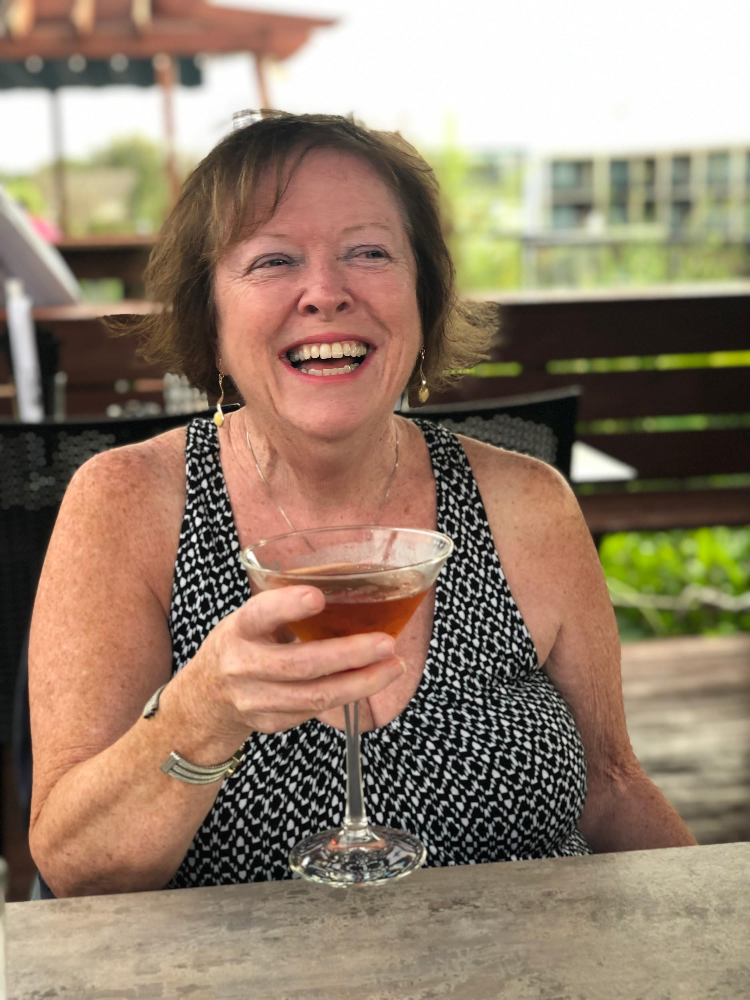
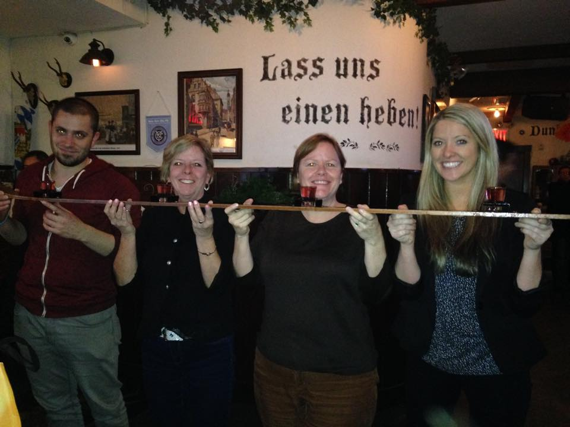

Everyone who knows Lynn Carre knows shes loves a good Manhattan. The first time she ever met my in-laws, I remember being a nervous wreck and could overhear my mom in the kitchen saying, “Can I get anyone a glass of wine? I gave it up for lent. But I didn’t give up whiskey!”

Another fun fact about Lynn Carre is that she brings her own Amarena cherries in tupperware to the bar, so that her Manhattan is just right. I guess those peasant maraschino cherries at Famous Joe's just won't do!

## Ingredients

- 2 oz. bourbon
- .5 oz. sweet vermouth (preferably Carpano Antica Formula)
- .5 oz orange curaçao
- 1 dash angostura bitters
- 1 dash Raegan’s no. 6
- Amarena cherries
- Orange rind

## Instructions

- Fill a pint glass with ice and add the bitters, followed by bourbon, vermouth, and orange curaçao.
- Stir and strain into chilled coup or martini glass.
- Garnish with orange rind and Amarena cherries.
