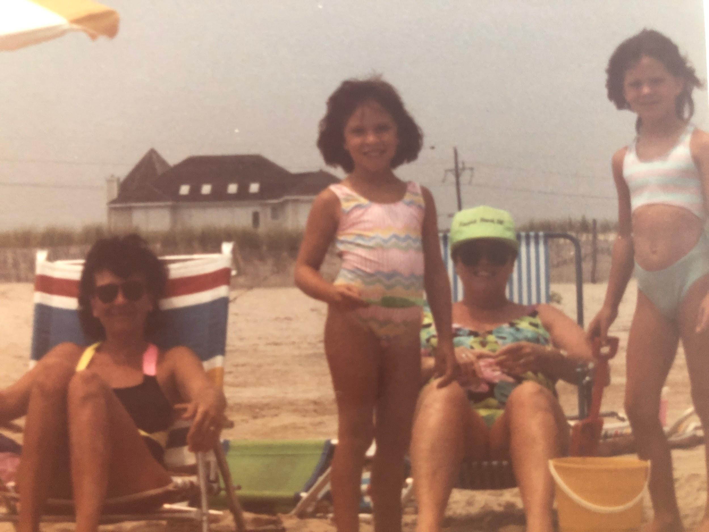

Another potluck favorite for Hoban parties! Don’t try and fancy this up with gourmet cheese, homemade dressing or fresh herbs. This works as is.

## Ingredients

- 1 lb rotini
- Kraft viva Italian dressing
- Salad supreme seasoning
- Bell pepper
- Canned black olives
- Cucumbers
- Tomatoes
- Diced cheddar cheese

## Instructions

- Boil rotini according to directions.
- Chop vegetables.
- When rotini is cooked, mix with half the bottle of Viva Italian.
- Add the vegetables and cheese.
- Sprinkle with Salad Supreme to taste. Before serving add the remaining Viva Italian.
