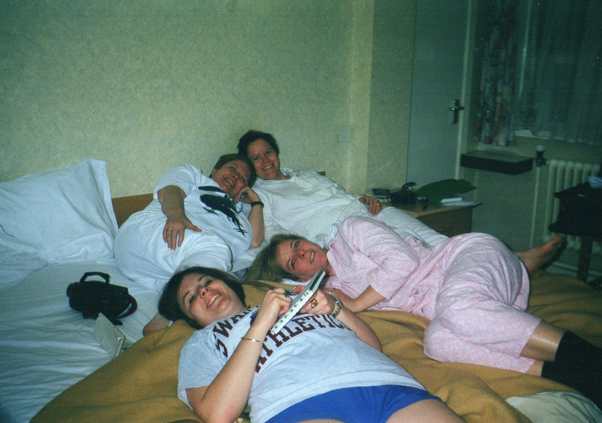
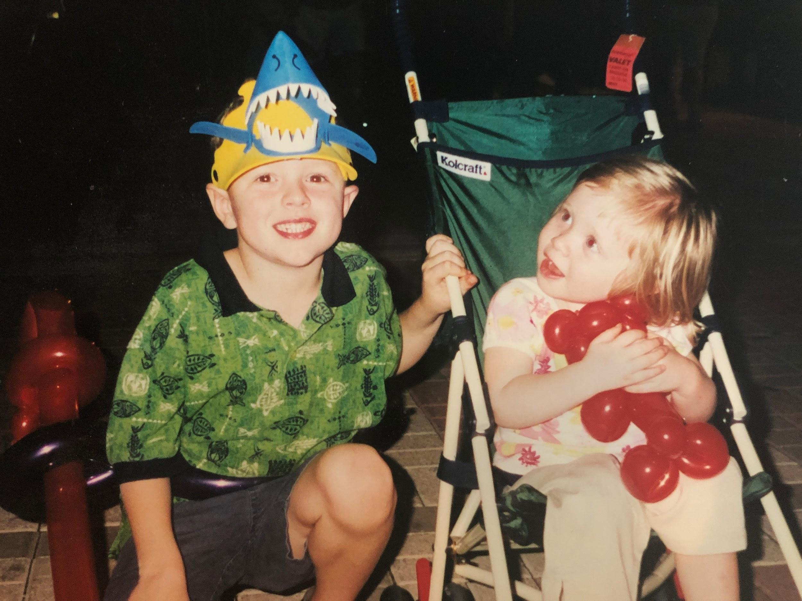

Connor and Irene’s favorite. Everyone’s favorite! It’s cheesy noodly perfection. Bonus points when Aunt Kate makes it with fresh tomatoes from her garden. This dish reminds us of the Ragan’s cozy kitchen, perched on bar stools around the kitchen island, with homemade iced tea out of mason jars (or a bottle of wine), telling stories and laughin’ and laughin’!

It’s cheesy and comforting and “only made with love” (which is always, enough).

## Ingredients

- 1 lb box of pasta
- 3/4 lb white American
- 3/4 lb sharp white cheese
- 1 can stewed tomatoes
- Cook pasta al dente by the box directs

## Instructions

- Preheat oven to 350°.
- Pour some of the stewed tomatoes in the bottom of your baking dish.
- Add one layer of pasta then one mixed layer of American and sharp cheese.
- Repeat, tomatoes, pasta and cheese. Repeat until baking dish is full.
- Add panko breadcrumbs to top.
- Bake for 30-45 minutes until cheese bubbles and breadcrumbs are browned.
- Serve as is, or, if you’re Connor Ragan, top with Old Bay!
