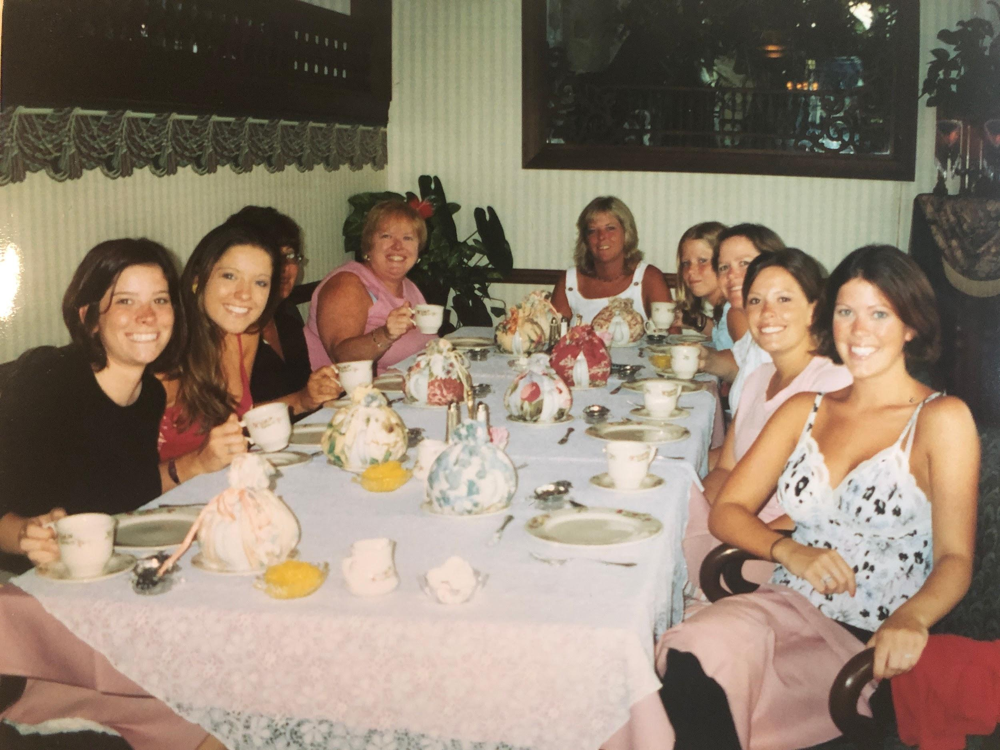

Joe Carre gets a lot of praise for cooking Thanksgiving turkeys and fancy shmancy meals but if you ask me, Lynn Carre makes one MEAN roast chicken with crispy crunchy flavorful skin and a homemade gravy to boot. A true “stick to your ribs” dinner, this is something I plan on making for my kids (hi Sammy!) for many years to come.

## Ingredients

- 1 whole chicken
- 2 carrots, peeled and roughly chopped
- 2 celery stalks, roughly chopped (reserving the bottom whites and leafy parts for gravy)
- 4 garlic cloves, smashed (but whole)
- 1 onion (reserving the tops and onion peel for the gravy)
- 1-2 tablespoons all purpose flour
- Good quality olive oil
- Salt and pepper (fresh cracked is best)
- Dried rosemary (or any other herbs or seasonings you please)
- Chicken broth (eyeball maybe 2-3 cups)

## Instructions

- Preheat oven to 350°.
- Pull out the giblets (Aka the neck, heart, and other terrifying things you find inside a whole chicken) and place in a small pot on the stove. To that pot, add chicken broth and the stems or “throw-away” parts of the veggies (tips and skin of onion, leafy ends of the celery, etc) and 1-2 smashed garlic cloves. Bring to a simmer.
- Place the chicken on the rack of a roasting pan. Add the chopped veggies and garlic to the bottom of the roaster.
- Drizzle olive oil all over the skin of the chicken and cover generously with salt and pepper. Then add the dried rosemary and any other herbs you like.
- Pop the chicken into the oven and rule of thumb is: Cook 20 minutes per pound (so I hope ya didn’t throw out the package that told you how much your chicken weighs because that’s something I would do).
- Important: During the last 20 minutes, add a little bit of chicken broth to the bottom of the roaster. (Why? Because if you put the broth in at the beginning, the chicken would steam and not roast. So don’t add any liquid or broth until the last 15-20 minutes of it cooking). Add about a cup.
- Meanwhile, check your simmering giblets. Mom says it’s ready when you can pull the meat off the neck. (Oh joy!) Once ready, throw out the heart and all the veggie solids but keep the neck and giblets, which you can dice into tiny pieces and set aside. (And then declare yourself a serial murderer.)
- Take the chicken out of the oven and admire its crispy crunchy skin - resist the urge to start eating immediately.
- Pour all remaining liquid from the bottom of the roaster into your small pot of gravy.
- In a separate bowl, whisk together equal parts flour and warm water into a “slurry” and quickly add to the gravy whisking rapidly and bringing to a boil. Keep whisking until it thickens. Then add the giblets back to the gravy. Taste for salt and pepper.
- Voila! You have yourself a fantastic juicy chicken dinner with a beautiful gravy you can serve over mashed potatoes. (My dad sometimes preferred white rice with gravy - something his mother, Marie, would make for him when he was growing up). :)
