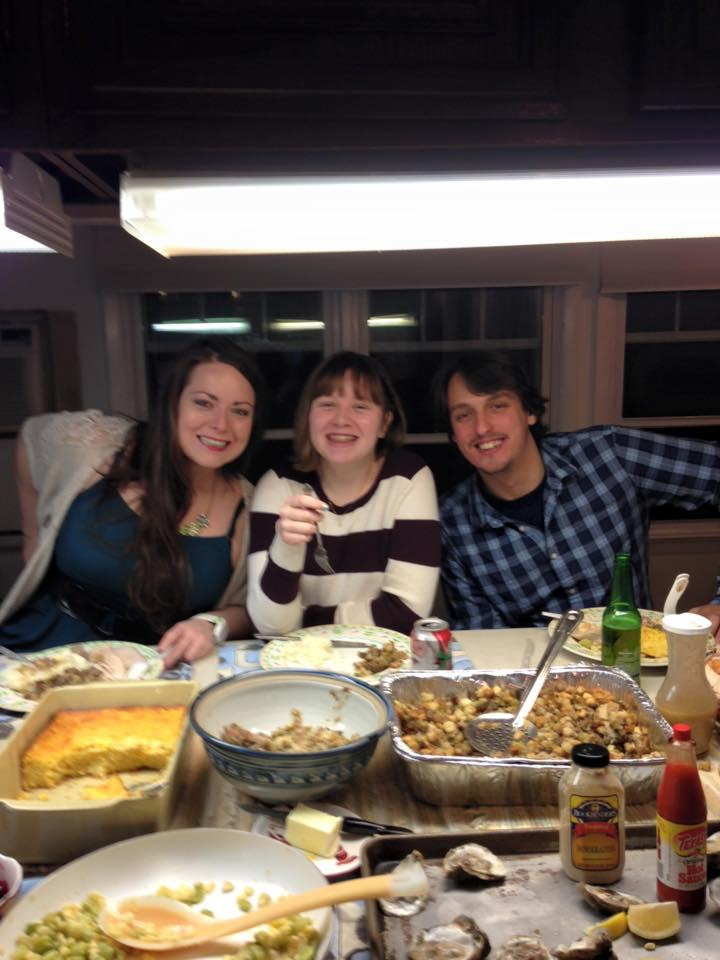
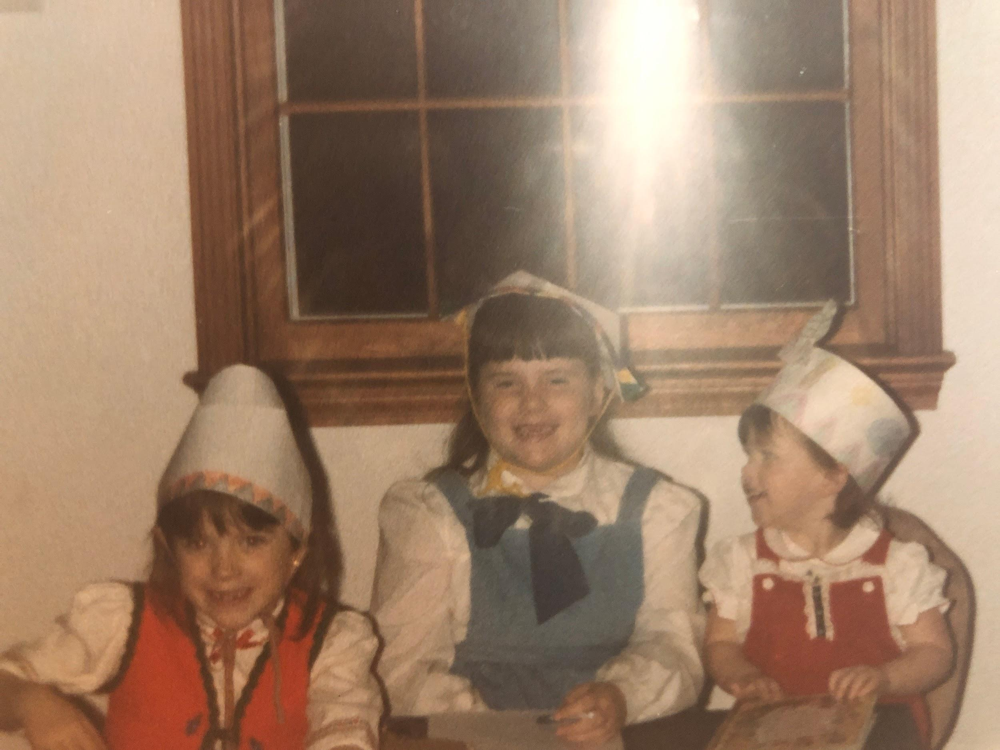

I think we all remember this from Thanksgiving years back! They make quite an impression.

Must be made in 10lb quantities or not at all!

## Ingredients

- 10 lbs potatoes (yukon gold)
- ½ container of sour cream
- One package of cream cheese (philadelphia block, regular none of that low fat stuff)
- Milk
- Butter
- Celery salt

## Instructions

- Boil the potatoes; Drain and peel them; Put in a pot.
- Add other ingredients kind of slowly and you should be able to tell by the consistency (and by tasting them) what they need.
- If you want to brown the top, put them in the oven at 350 for about a half hour.
