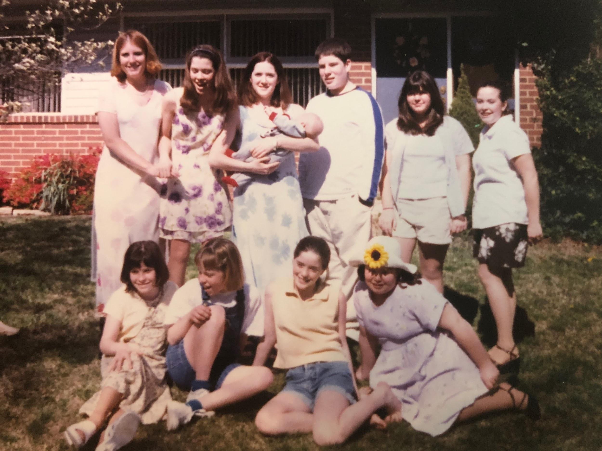

You can hardly wait for this to cool before trying some! Goes great with a Ham or any hot sandwich. And if you’re Aunt Kate, you’ll enjoy this with lots of fresh cracked pepper (a pro tip that converted Kathleen from a once potato-salad-hater, to a #1 potato-salad-lover!).

## Ingredients

- 5 lbs potatoes
- 6 hard boiled eggs
- 5 stalks of celery
- 2 medium onion
- Celery seed
- 1 ½ cups mayo
- 3 T mustard
- 2 T sugar
- 3 T white vinegar
- Salt & pepper to taste

## Instructions

- Peel and boil potatoes until soft.
- Hard boil eggs (place in cold water, bring to boil and let sit for 20 mins rinse with cold water).
- Once eggs and potatoes are cool cut potatoes into bite sized pieces, slice eggs.
- Mix together ingredients for dressing.
- Fold dressing into potato and eggs.
- Sprinkle chopped onion and celery throughout.
- Top with Paprika and Celery seed.
