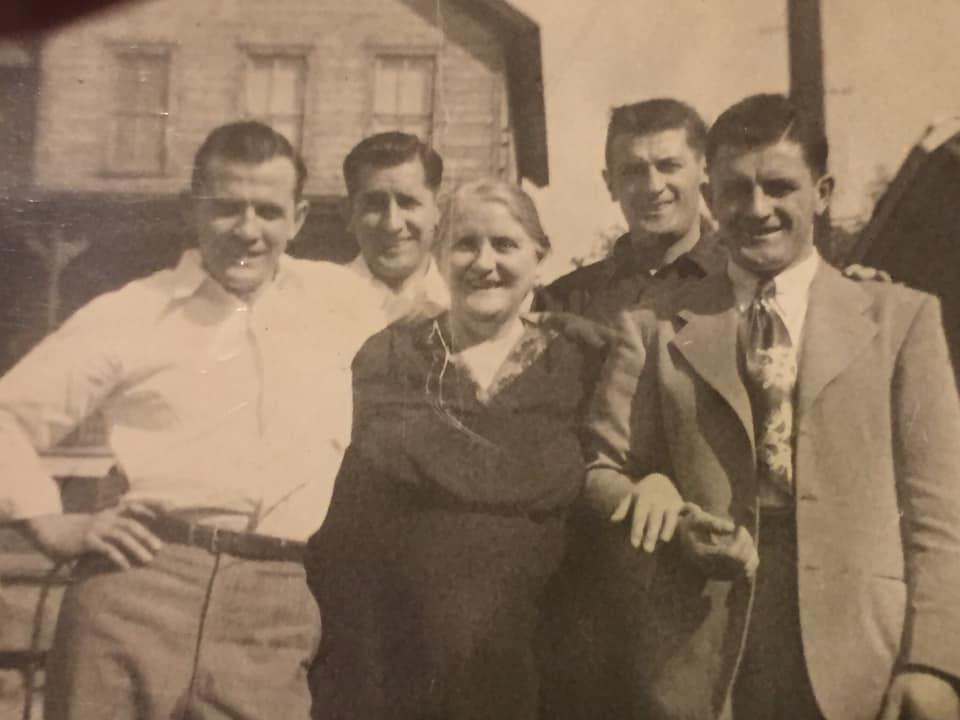

Requested for a decade of birthdays. Tastes great cold, eaten out of the tupperware while standing in front of the open fridge in the old Carre kitchen.

## Ingredients

- 1 head fresh broccoli, steamed
- 4 boneless skinless chicken breast, boiled and chopped
- 2 cans condensed cream of chicken soup (Campbell’s only)
- 1 tbsp. Fresh lemon juice
- ½ c. shredded sharp cheddar cheese
- ⅓ cup mayonnaise
- ½ cup bread crumbs
- 1 T. melted butter
- 1 tbsp. curry powder
- 2 c. cooked rice

## Instructions

- Heat oven to 400.
- Place chicken and broccoli in casserole dish.
- Stir soup, curry powder, lemon, mayo, cheese, salt and pepper in a bowl.
- Pour soup mixture over chicken and broccoli.
- Sprinkle with cheese.
- Stir breadcrumbs and butter in small bowl.
- Sprinkle breadcrumbs over the cheese.
- Bake for 20 minutes.
- Serve over rice.
