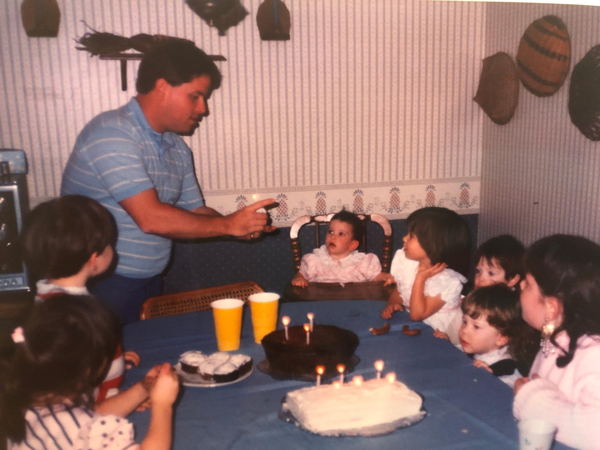

Dirt was an iconic dessert at our birthday parties, and this recipe also includes the opportunity for “Sand!”

### Dirt

## Ingredients

- ½ cup butter, softened
- 1 (8 oz) package cream cheese, softened
- ½ cup confectioners’ sugar
- 2 (3.5 oz) packages instant French vanilla pudding mix
- 3 ½ cups milk
- 1 (12 oz) container frozen whipped topping, thawed
- 32 ounces of Oreos
- Gummy worms!

## Instructions

- Chop cookies very fine in a food processor.
- Mix butter, cream cheese, and sugar in a bowl.
- In a large bowl mix milk, pudding and whipped topping together.
- Combine pudding mixture and cream mixture together.
- Layer in a flower pot, starting with cookies and then the cream mixture. Repeat layers.
- Chill until ready to serve. Garnish with gummy worms.

### Sand

## Ingredients

- 15 ounces of vanilla wafers
- 1 (8 oz) package cream cheese, softened
- ¼ cup butter, softened
- ⅔ cup powdered sugar
- 2 (3.5 oz) packages instant French vanilla pudding mix
- 2 ¾ cups milk
- 1 (12 oz) container frozen whipped topping, thawed
- Swedish Fish

## Instructions

- Chop vanilla wafers in a food processor until they resemble sand.
- In a smaller bowl, combine cream cheese, butter, and powdered sugar.
- In another larger bowl, mix pudding with milk.
- Add pudding mixture to the cream cheese mixture.
- Fold in all of the cool whip.
- Layer into a bucket alternating between sand and pudding layers.
- Chill until ready to serve. Garnish with Swedish Fish!
