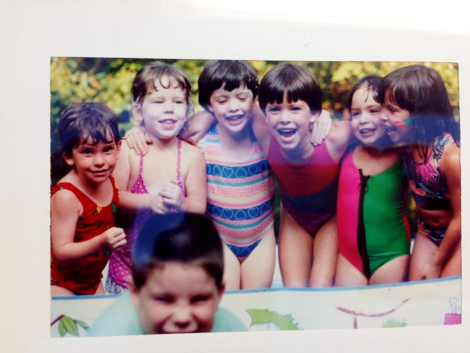

A Carre (and daycare) family favorite! Reminds us of summers on Carson road, calling in all the kids for lunch from the pool. We’d sit with wet bathing suit bottoms on the carport and fuel up on this noodly delight for an afternoon of swimming, rollerblading, boomboxes, and sidewalk chalk! *Note: You can substitute chicken with tuna, and voilà! - you have tuna noodle casserole!

## Ingredients

- 2 boneless chicken breasts
- 2 cans Campbell's cream of chicken soup
- ⅓ bag of frozen veggie mix (carrots, peas, corn, and green beans)
- 1 bag of “flippy” egg noodles (Pennsylvania dutch extra wide!)
- ½ cup sharp cheddar cheese
- Butter
- Premium crackers, crushed into “breadcrumbs” (my mom would use regular breadcrumbs, but I find premium crackers to be delightfully nostalgic and the perfect crunchy topping!)

## Instructions

- Preheat oven to 375.
- Boil chicken and then dice up.
- Cook noodles until al dente - they’ll continue to cook when baking in the oven, so you don’t want to overcook them.
- In a bowl, mix the 2 cans of soup, the cheddar cheese, frozen veggies, chicken, and noodles. ***NOTE: it should be goopy and saucey - if it seems dry, either add another can of soup to it or a ½ cup of mayo works too. #health
- Spoon the mixture into a baking dish, and spread evenly.
- Melt a big pat of butter, and mix in with the crushed Premium crackers (or breadcrumbs).
- Top casserole with the buttery crackers, pop in the oven at 375, and cook until bubbly, about 20-30 minutes. At the very end, broil on high to get the top browned and crunchy.
- TA-DA! Enjoy childhood in a bowl!
