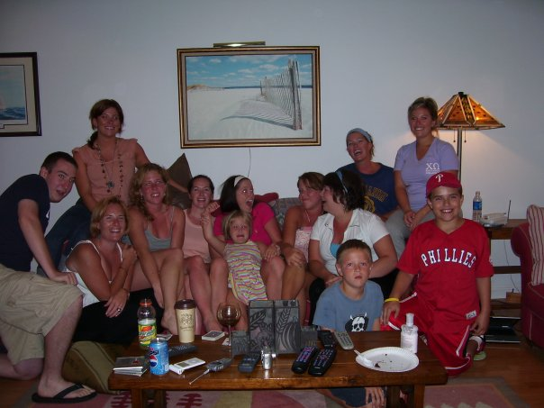

This is a Chef Lucas Sousa recipe, adapted by Kathleen! Perfect for a lazy Sunday, or even for a dinner party with friends who want to pour some wine and get their hands dirty! All you need is time, kitchen counter space, and a pasta machine!

## Ingredients/Supplies

- Pasta machine
- 11 egg yolks
- 1 egg
- Juice of 1 lemon
- 1 tablespoon EVOO
- 1 tablespoon salt
- 500 g semolina flour
- More flour for surfaces and handling the dough

## Instructions

- Make a well (Aka a mound of flour - like a volcano!) on a clean kitchen surface and hollow out a hole in the center. Add the egg, yolks, lemon, evoo, and salt and start whisking at the center of the well with a fork, slowly incorporating more flour from the outside walls into the egg mixture. Keep whisking and keep adding in more flour until it’s eventually all incorporated and you have a sticky paste/dough situation.
- Kneading: bring in any leftover flour on your surface and start kneading it into the dough, rapidly for 5 minutes or leisurely for 10 minutes. Keep kneading until it’s reached a smooth elastic consistency.
- Wrap it in plastic wrap and place in the fridge for at least an hour, or even overnight.
- Take the dough and slice it in quarters. Take each quarter, roll into a ball, and then flatten into a manageable piece for the pasta machine.
- Place through the pasta machine on its widest setting, then fold it up again, and put back through. This is called “laminating” the dough so that its has a nice texture.
- Reduce the width and adjust the pasta machine setting to your liking (linguine or spaghetti - or I like to keep it in wide sheets and cut it in strips myself for rustic pappardelle shape) and feed through one last time.
- Bring a pot of water to a rolling boil. Drop in pasta for 10-15 seconds is all. You can place in an ice bath to halt the cooking or serve right away and toss with your sauce of choice.
- I thoroughly enjoy this with a homemade bolognese sauce, or with vodka sauce and peas! In Italy, we had this with homemade pesto. You could also do a pork Ragu! So many pasta-bilities! (I said it, you heard that right) Enjoy!
