## Coochie (verb, adjective, noun)

Comfortable, snuggly, relaxed.

*Should we pop in Now and Then, put on our jammies and get all coochie on the couch?*

Origin: Barbara Bradigan

## “Did anyone say you were nice?” (expression)

To be asked anytime you come back from anywhere, interacting with anyone. The answer is typically yes.

Origin: Grandma

## “What do you charge to haunt a house?”

A devastating insult implying you look bad enough to cause someone a fright. Appropriate when said to a group, usually when posing for a photo, not recommended to say to an individual. VERY TRUE during our adolescent years.

Origin: Uncle Jack

## Tickled (adjective)

The state of being excited or pleased.

*I went to Value City to pick up school shoes for the girls and there was a clearance on kids shoes; I was just so tickled.*

Origin: Grandma

## “Mmmm, you made my favorite ...FOOD!”

Said when any type of food is put out to eat.

Meant as a compliment.

Origin: Jack Hoban

## “No talking, no laughing, and no having fun!” (expression)

Likely to be heard at sleepovers.

Origin: Uncle Jack

## Jesus Christ (noun)

A declaration of indignation, horror or anger

*anyone says literally anything*

*Joe Carre: Oh, Jesus Christ, give me a break!*

Origin: Joe Carre

## “Don’t load up!“ (expression)

A request to not go overboard on a buffet line. Not recommended to say to anyone, especially your wife, and is often responded to with a cold shoulder and withering stare.

Origin: Uncle Chris

## “The women ate all the springrolls”

Shouted in horror after realizing that after spending hours making homemade spring rolls, the sitting, chatting, drinking women ate all of them without saving you any. Can be combined with a ‘Jesus Christ’ for maximum impact.

Origin: Joe Carre

## Glued together (adjective)

An unfortunate state where two cousins are joined at the hands or arms, unable to unlink. The only cure is a sleepover at one cousin’s house. A trade of one sibling for another is often offered.

*Kathleen can’t go home right now, we’re glued together. Maybe Lauren can go home with you instead, Aunt Lynn, does it matter which two kids you get?*

## Holidazzle (noun)

The spirit of Christmas, headquartered at 1425 Carson Rd.

## “Jump in the car...”

The opening line of an incredibly age inappropriate song taught to and then gleefully performed by small children at a summer day camp.

Origin: Welfare Camp

## “I can’t wait for tomorrow...”

Said in hopes that the recipient will ask “why?” so that you can respond, “because I get better looking everyday.” An eyeroll is the appropriate response.

Origin: Uncle Jack

## “I only made it with love, I hope that’s enough!” (expression)

Said to loved ones after making a “stick to your ribs” dinner.

Origin: Aunt Kate

## KFC (Kathleen Fan Club)

A group of small cousins, all vying for the affection of Kathleen.

Members: Ali, Jill and Colleen

Origin: Sean Vernon

## Tickle Torture Team (noun)

Neighborhood gang.

Members: Jill, Kathleen, Colleen and Ali

## “Looks like somebody was here”

Used on Christmas morning to suggest that Santa came the night before and left a big ol’ haul.

Origin: Jack Hoban and Lynn Carre

## “So what else?” (expression)

Typically said when there’s a pause in conversation. Meant to show interest in you and your life. Often followed by “Tell me everything!”

Origin: Aunt Lynn

## “We hate to see you go…” (song)

Sung by vacation-starters to mock vacation-enders

## “Don’t have any fun without me!” (expression)

Used when one cousin can’t attend something other cousins are attending.

## “Shot a rabbit” (expression, verb)

To toot.

## Tie a pork chop around your neck (expression, verb)

A method of finding friends, usually done out of desperation.

Origin: Uncle Jackie

## “He’s not dead, he’s on vacation!” (expression)

Replied when an onlooker is concerned about the aliveness of your relative who takes a little snooze after a few too many drinkies.

## “Porty papers” (noun)

Important papers, typically found in the backpack of school aged children.

*gets home from school and opens backpack*

*How was your day? Let me see those porty papers!*

## “You’re Not My Father!!!” (expression)

Alarm defense mechanism to shout at an approaching stranger, or a very large wave.

## “Boldilocks” (noun)

Used to describe misbehaving or willful children

Origin: Grandma

## Laughin and Laughin” (expression)

Used to describe all the fun we have when we’re together.

Origin: derived from Elaine Benes “I told them - ya didn’t. And I laughed and I laughed.”

## Photos

These photos are printed beside the glossary in the book. They are not captioned, so they are gathered here instead of being inserted into a definition.

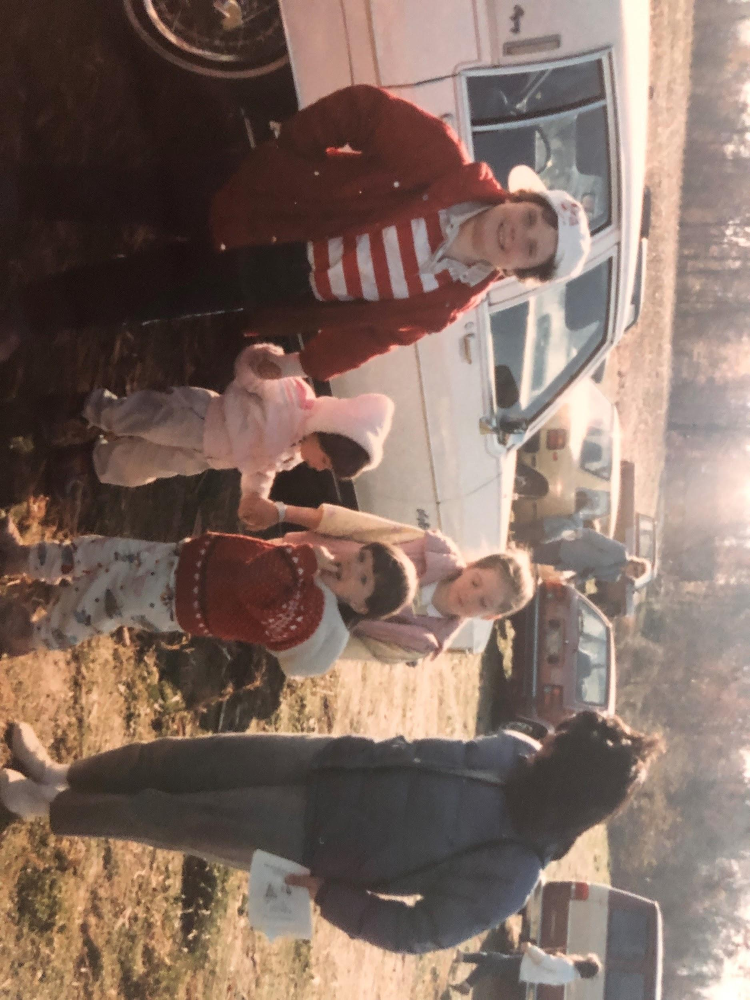

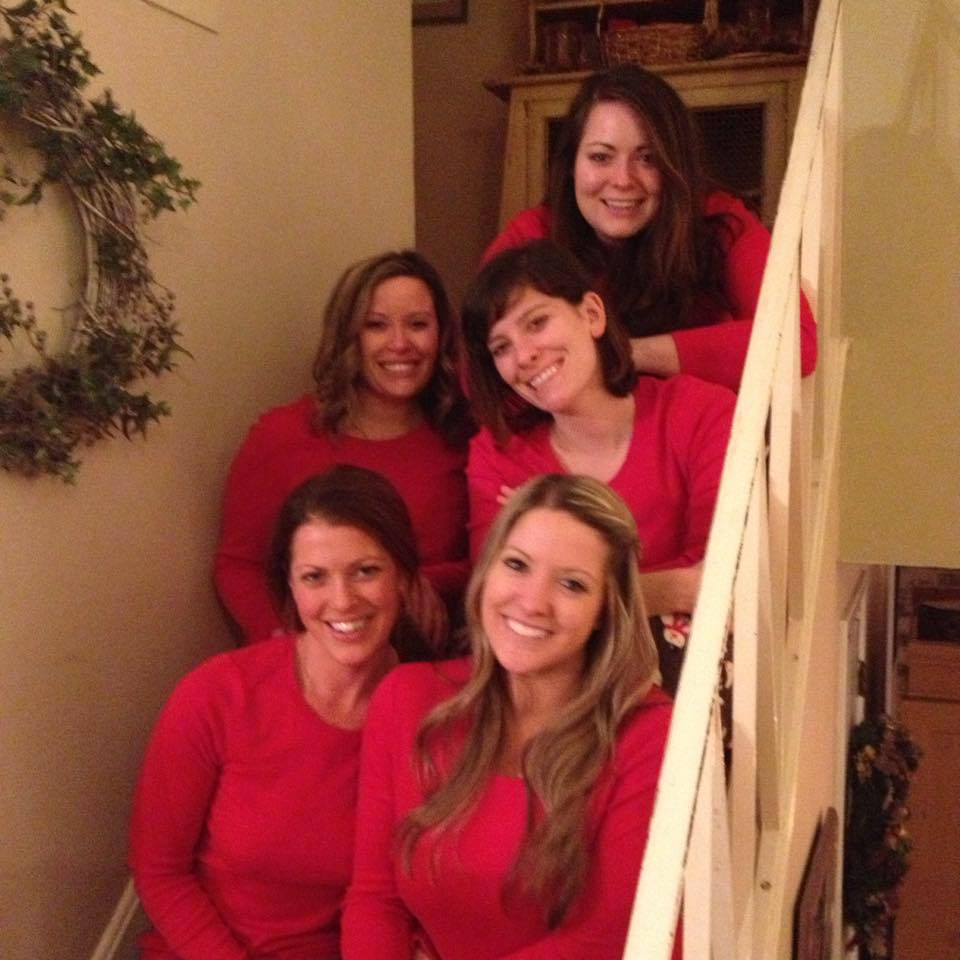

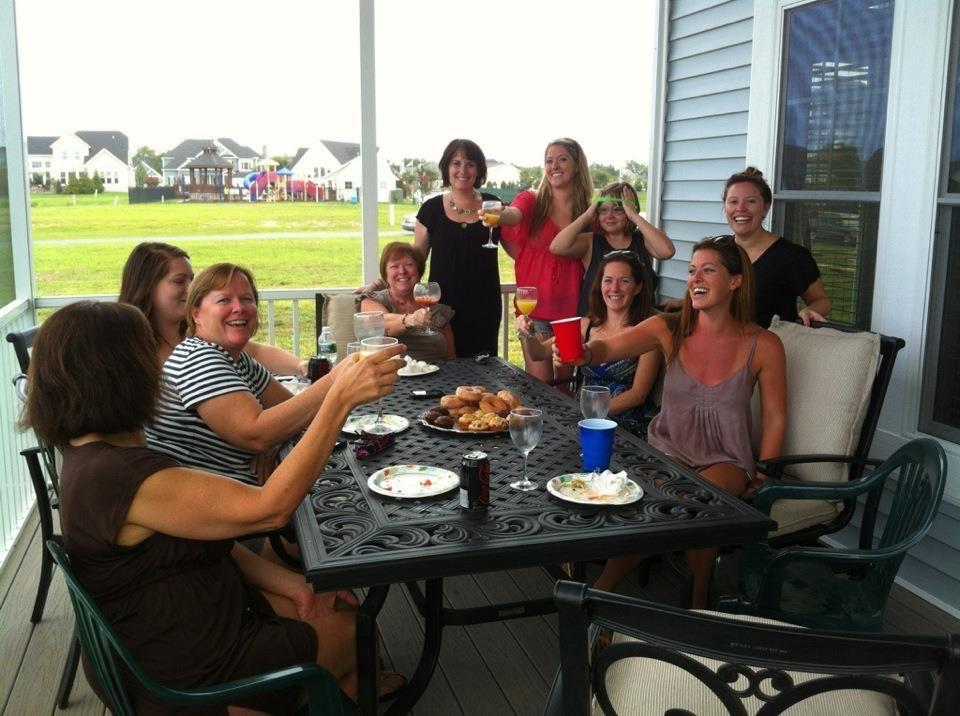

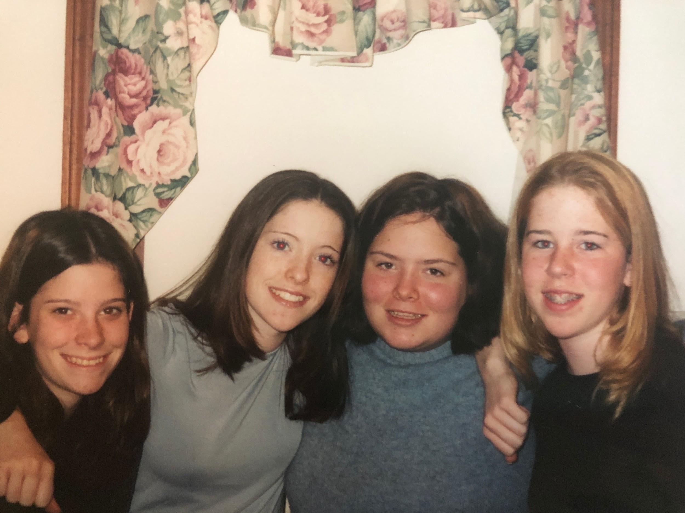

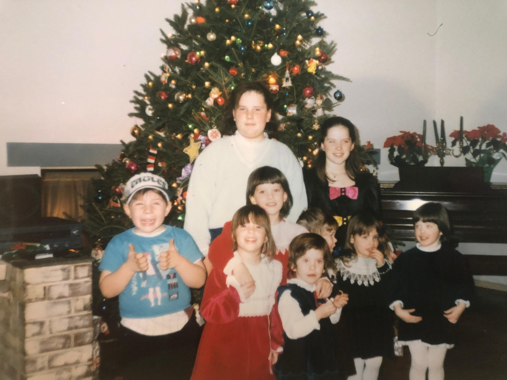

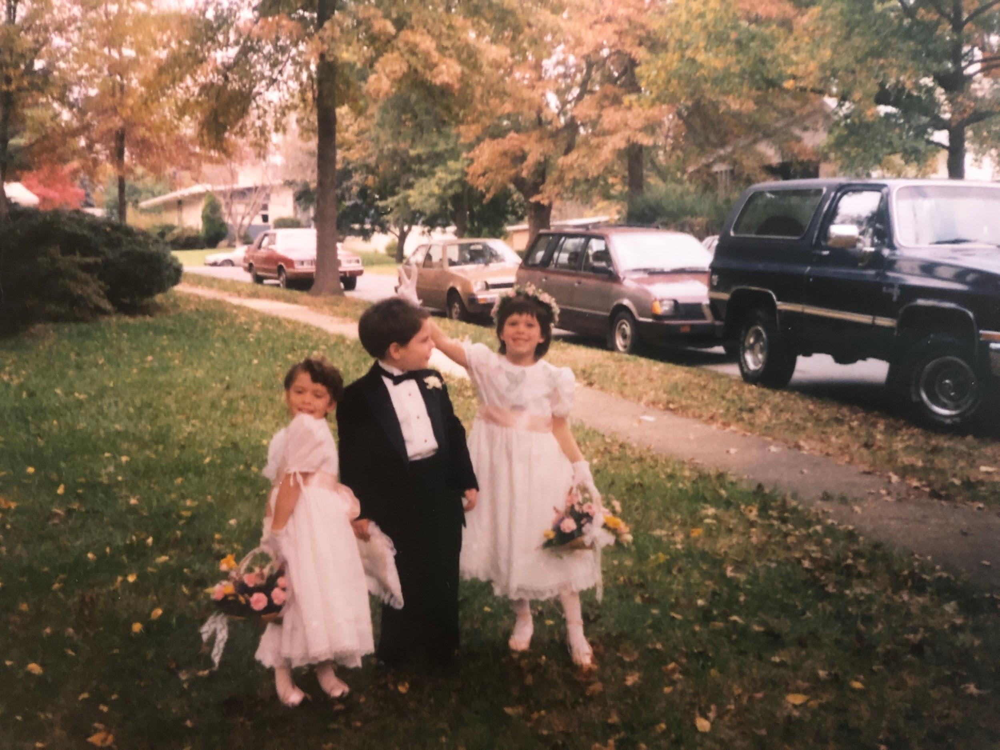

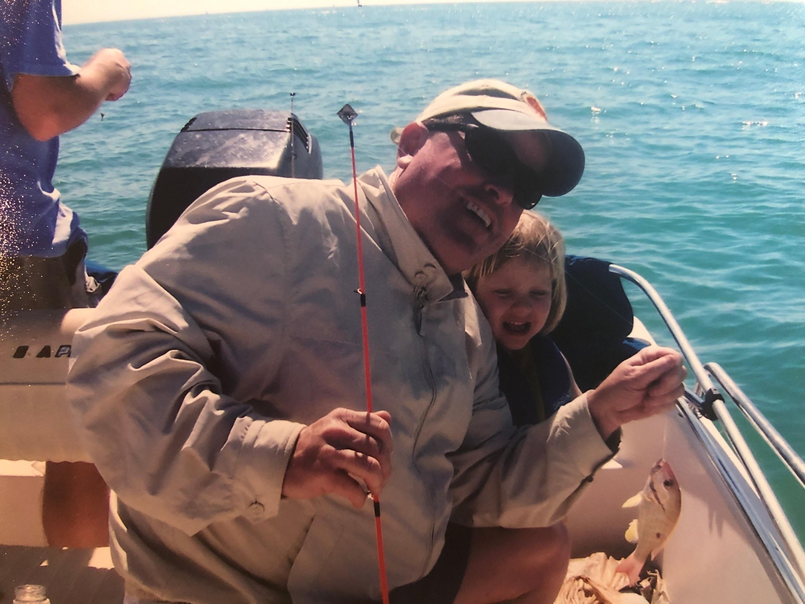

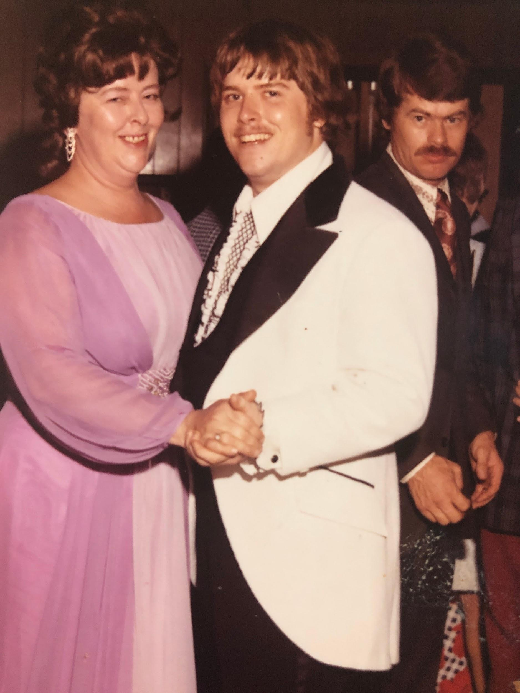

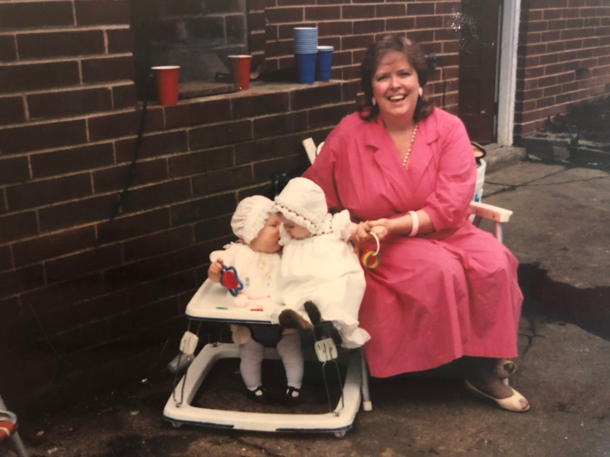

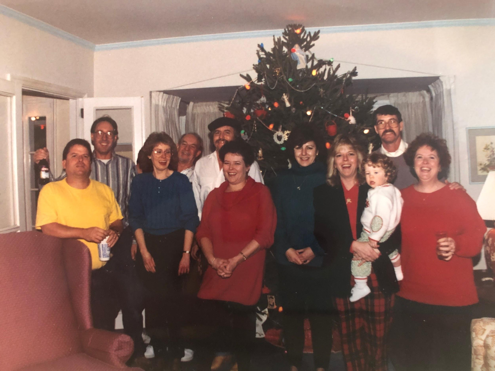

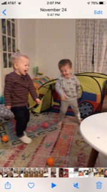

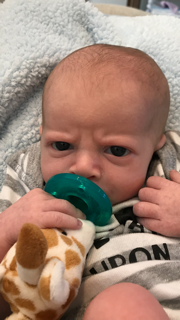

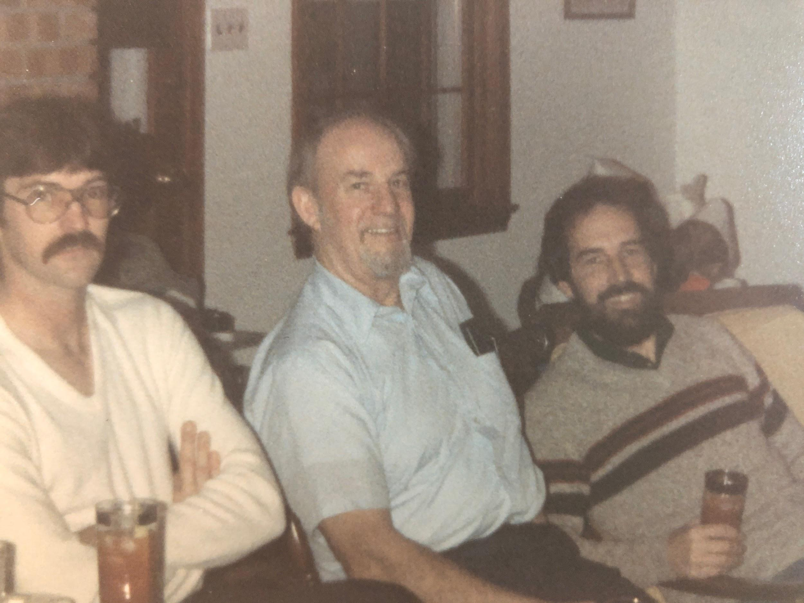

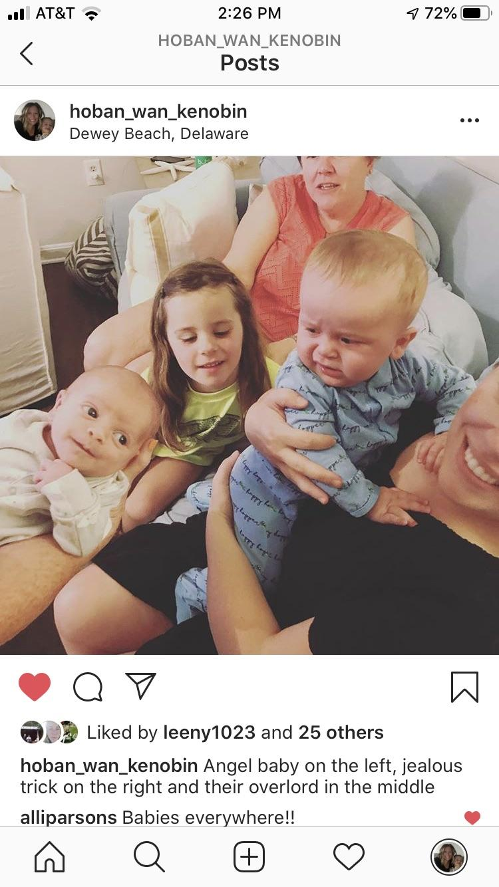

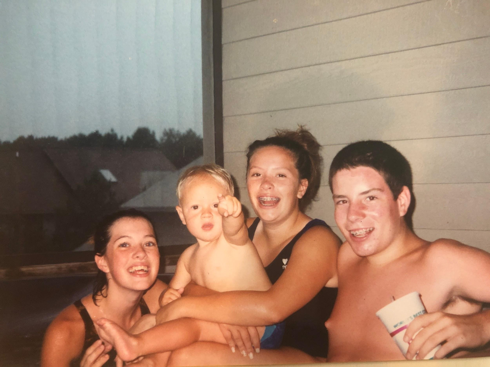
