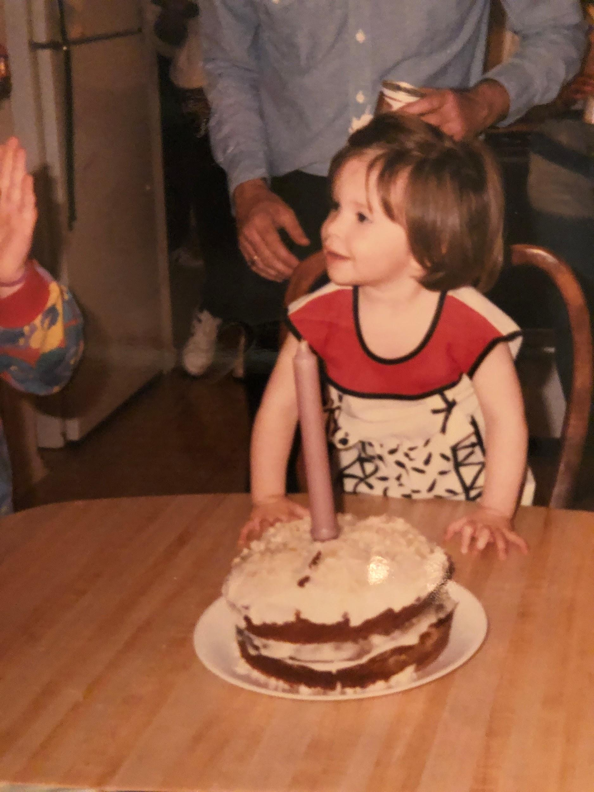

While Granny may technically only be biologically related to Ali and Lauren, she will always be Granny to all the Hobans. Her pound cake is famous and an easy dessert for us Hobans who stink at baking (except for Irene of course!)

## Ingredients

- 1 lb butter softened
- 3 cups sugar
- 6 eggs
- 4 cups all purpose flour
- ¾ cups milk
- 1 teaspoon almond extract
- 1 teaspoon vanilla extract

## Instructions

- Preheat oven to 300°.
- Cream the butter.
- Gradually add the sugar.
- Add eggs one at a time, beating after each.
- Add flour to the creamed mixture, alternating with the milk (begin and end with flour).
- Add the extracts.
- Bake in a greased and floured bundt pan for 40 minutes.

This is delicious plain but also yummy with a dusting of powdered sugar, homemade whipped cream, strawberries - or all 3!

*A favorite memory growing up at birthday celebrations was never having birthday candles. Whichever aunt was hosting would rummage around in a junk drawer saying “I just bought some, they must be here somewhere!” - knowing damn well there were no birthday candles in that house. After this short charade, they would shrug, grab an Advent candle from some drawer, plop it in the middle of a cake and we’d all sing our little hearts out! We Hobans never did let convention stop us from having a good time.*
