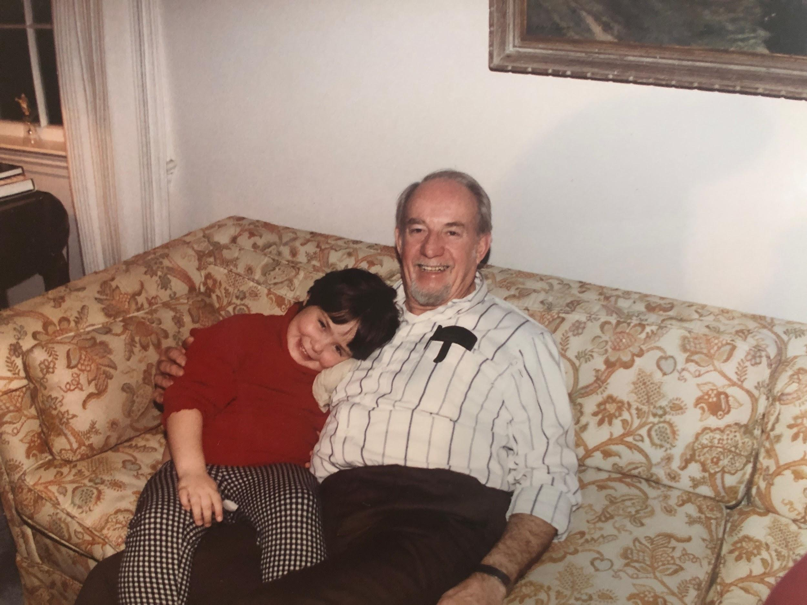

## Ingredients

- Starving children
- Two slices of thick white bread (like Arnold’s)
- A stick of Land o Lakes butter
- Land O Lakes white American cheese sliced medium thick

## Instructions

- Cover each slice of bread with about a quarter of an inch of butter.
- Add 2-3 slices (evenly distributed) cheese (cooked bacon or fresh tomato can be added here).
- Grill on medium heat, try to flip only once.

Maureen’s tip: If your bread is finished but your cheese is not, zap in microwave for 10-15 seconds. Enjoy with a dollop of ketchup!
