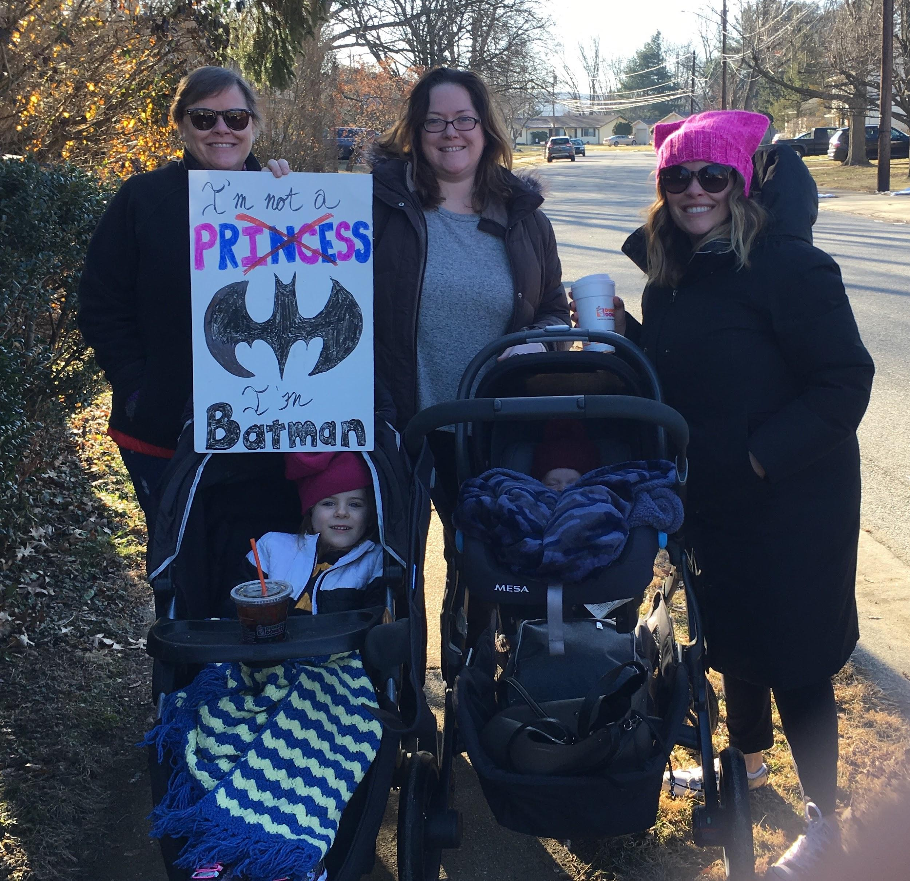

Nothing beats this labor of soup love in the kitchen. This is a go-to in our veggie-friendly house.

These ingredients are the starting measurements, but I rarely measure. Just throw it all in.

## Ingredients

- ¼ cup olive oil
- 1 cup diced onion
- 2 tsps minced garlic
- 4 large carrots, thinly sliced
- 2 cups peeled and cubed butternut squash
- 12 cups vegetable broth (or chicken for ya poultry eatin’ folks)
- 2 red potatoes, cubed
- ½ tsp dried thyme
- Salt and pepper to taste
- 4 cups finely chopped kale leaves
- 1 (16 oz) can great Northern Beans, rinsed and drained

## Instructions

- Heat the oil in a large pot over medium heat. Stir in the onion and garlic; cook and stir until the onion has softened and turned translucent, about 5 minutes. Stir in the carrots and butternut squash; cook and stir until squash begins to brown, about 15 minutes.
- Pour in the broth. Stir in the red potatoes, thyme, salt, and pepper. Bring to a boil. Reduce heat and simmer until vegetables are tender, about 45 minutes.
- Stir in the kale and great Northern beans, and simmer until the kale is tender, about 10 minutes.
- Pour about 3 cups of the soup into a blender, filling the pitcher no more than halfway. Do not burn yourself...so get a towel or something padded in case the blender is hot! Puree the 3 cups of soup in the blender, and return the pureed portion of soup to the pot.
- Feast!
