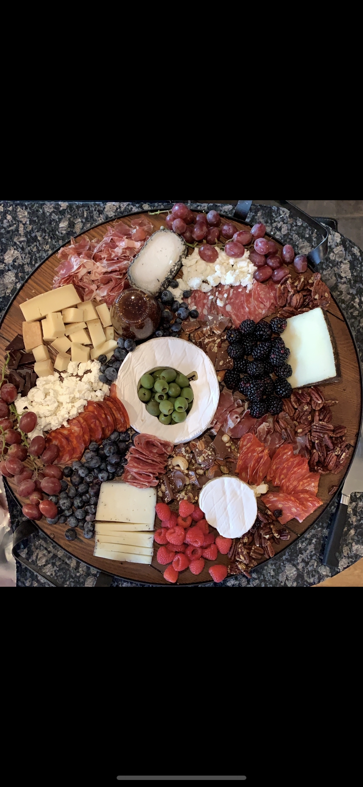

A known staple at any large gathering because it’s the only thing Joanna knows how to make.

Preferably served on a very large elegant board. Don’t skimp on filling every square inch on the cheeseboard! Make sure to cover before the party starts or all of the people standing around in the kitchen will pick at it and ruin the entire aesthetic.

Mentally prepare to feel incredibly fancy, bougie and special.

## Ingredients

- 1 Large wheel of brie
- 2 soft cheeses (goat), one with herbs or other rind
- 2 sharp cheeses (sheep or cow)
- 2 types of sliced sopressata, chorizo or other spicy cured meat
- Prosciutto
- Accompaniments should depend on theme and include produce, crunch, dip, garnish ○ Theme 1: toasted pecans (recipe below), blueberries, blackberries, red grapes, 85% dark chocolate bar/or chocolate bark, fig or other preserve, rosemary sprig garnish ○ Theme 2: marcona almonds, raw radish, cornichons, crunchy baguette, whipped butter with sea salt, honey, lavender sprig for garnish ○ Theme 3: pink grapefruit, cavalstrono olives, smoked salmon, creme fraiche, mini bagels/croissant, hard boiled egg, garnish will dill ○ Theme 4: strawberries, nutella, pomegranate, chocolate bonbons, small cookies, 85% chocolate bar, candied pecans (garnish with champagne grapes, or candy canes, or wrapped hard candies- depending on holiday or color)
- Crackers, breadsticks, baguette

## Instructions

- Start with cheese, cut into different wedges/slices/etc. (Brie wheel should be centered on board).
- Add meats folded into florets or a “river” across the board.
- Heat a large cast iron skillet and add pecans.
- Toast pecans, tossing frequently and adding flakey salt and pepper.
- Add tsp butter, paprika, sugar, cinnamon, and small amount of cayenne.
- Remove from heat once pecans are coated and toasty.
- Add produce in different sections of the board, hugging cheese or meats already placed.
- Add “crunch” (nuts/crackers/chocolate bar pieces/etc), hugging ingredients already placed.
- Add dips.
- Repeat steps 1-4 to fill any gaps.
- Add garnish.
- There should be no gaps on the board- every square inch should be filled.
