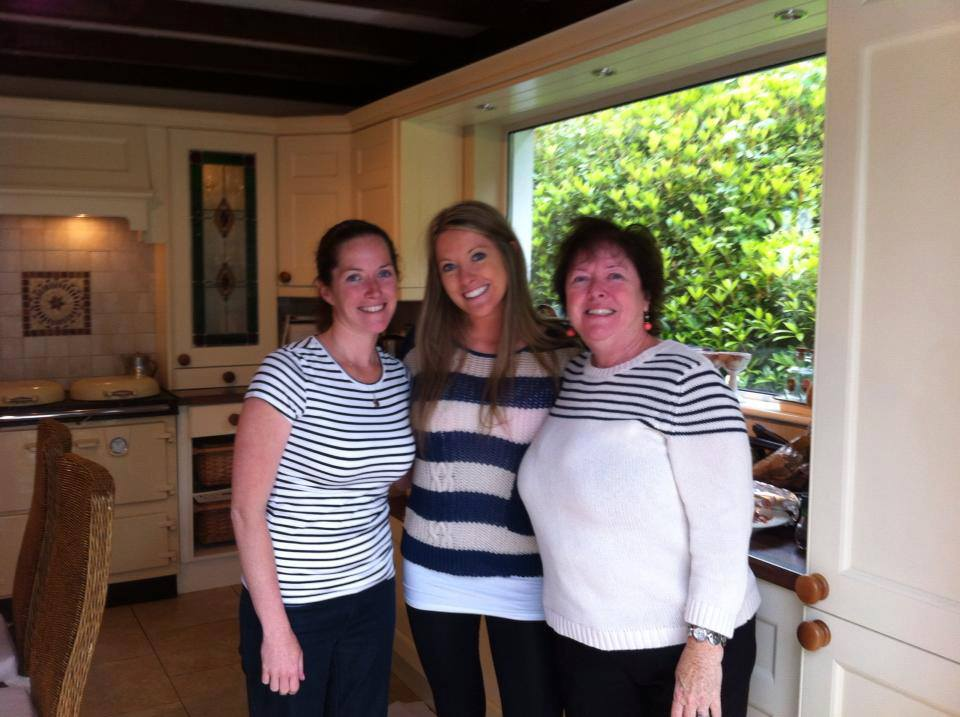

Eat it plain. Eat it topped with cherries. Eat it gluten free if you’re Joanna Carre and spoiled by your father who makes a separate pie just for you. :) These cheesecakes are a Joe Carre classic.

## Ingredients

- Graham cracker crust (purchase or make your own)
- 2 tbsp Butter, melted
- 1 ½ c. Sour Cream
- ½ c. Sugar
- 2 eggs
- 2 tsp real vanilla extract
- 1 lb cream cheese (Philadelphia brand, duh), room temp, broken into small pieces

## Instructions

- Pour the melted 2 tbsp butter over the cracker crust
- Blend sour cream, sugar, eggs, and vanilla in a blender for 1 minute. Add the cream cheese. Blend until smooth. Pour into crust.
- Bake in the lower third of a 350° oven for 45 minutes.
- When baking is finished, turn oven to broil. Broil the cheesecake until the top begins to show attractive spots of brown. Remove from oven.
- Refrigerate for 4 hours, preferably overnight, before cutting and serving.
