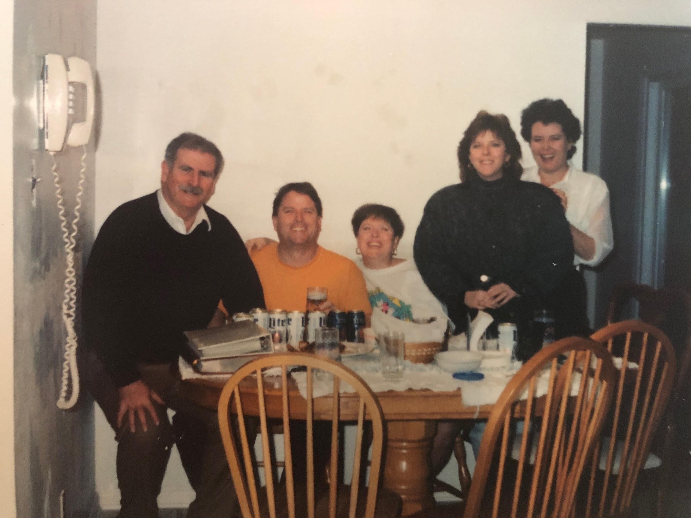

This is only to be made for funerals. You’re not really allowed to make it otherwise. If you walk into Joe Carre’s kitchen and smell his wonderfully aromatic dish, you must ask, “who died”?

## Ingredients

- 3-4 lbs cubed veal
- Flour
- Olive oil
- 1 lb italian sausage (not traditional, but this is how Joe Carre rolls)
- 10 oz white mushrooms
- 1 lg yellow onion
- 4-5 cloves garlic
- 1 lg (or 2 sm) green peppers
- 28 oz can whole tomatoes, crushed by hand
- 28 oz can crushed tomatoes
- Italian seasonings, fresh or dry

## Instructions

- Flour the cubed veal. Heat olive oil in a pan, and saute until brown.
- Add tomatoes, crush in hands.
- Let cook for 1 ½ hours.
- Cook sausage separately in a pan with water (you don’t want the grease in the stew). Cut up small.
- If you want, saute veggies as well.
- Add sausage and vegetables to stew.
- Taste. If it’s too acidic, add sugar.
- Serve on crusty rolls or over noodles.
