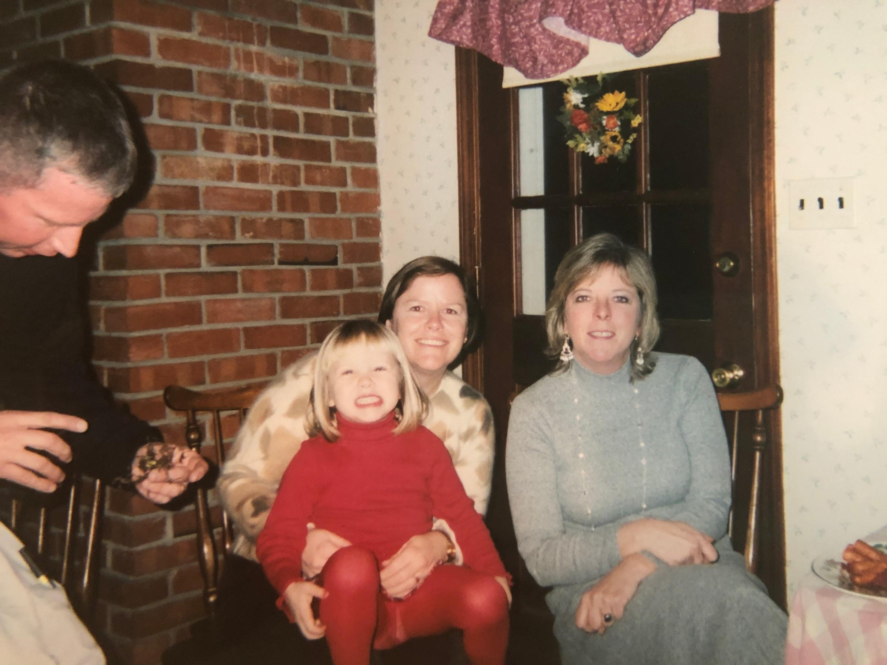
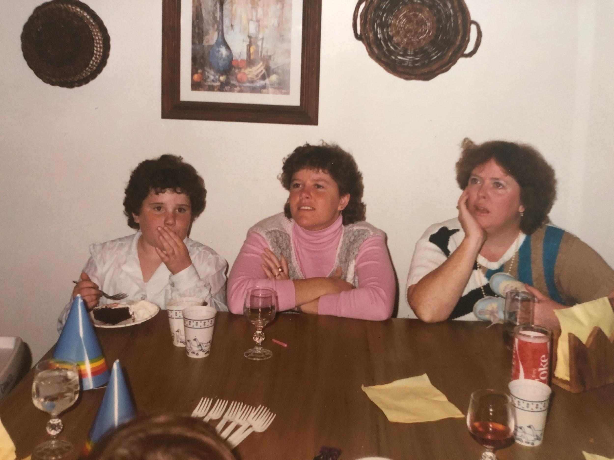

Never start a party without 15 unmatching bowls full of salty and sweet snacks. Be sure to hover constantly to refill in between cigarette breaks. Best enjoyed by Hoban women “laughin’ and laughin’!”

## Ingredients

- Herr’s & Utz chips
- Pretzel rods
- Soft pretzels
- Doritos
- Almond M&Ms
- Twizzlers
- Cheez-its
- Cereal bowls
- Crystal candy dishes
- Children’s plastic bowls
- Baskets lined with napkins

## Instructions

- Fill bowls.
- Refill bowls (careful not to interrupt the chatter of cackling Hobans).
- Cigarette.
- Refill bowls.
- Cigarette.
- Hope no one notices it’s past 9pm and dinner hasn’t been served.
- Ziploc soft pretzels and send home with party guests (honorable mention to Alli Parsons).
- End the night bellowing “The Man Who Shot Liberty Valance” with Yuengling in hand.
