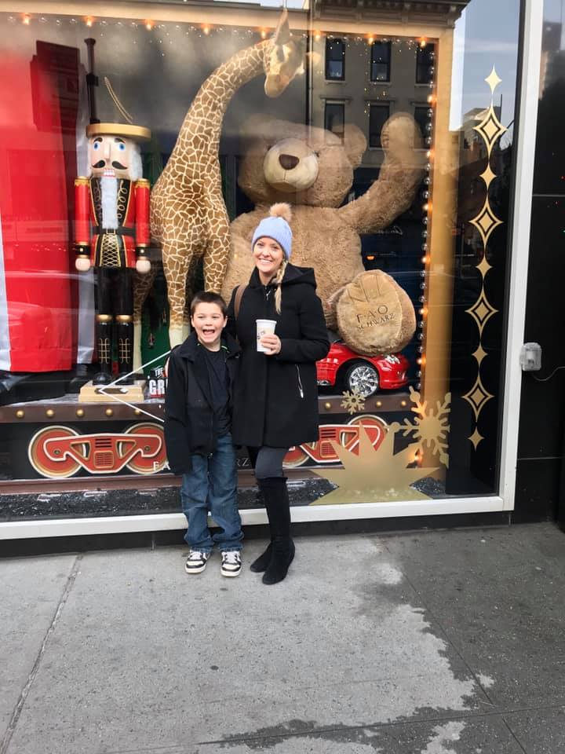

This has become a new fall favorite in our household. We like to make it around Halloween and Thanksgiving, and it’s a perfect side dish for Friendsgiving!

## Ingredients

- 1 box orecchiette pasta
- Fresh sage (5-6 leaves, torn)
- 4 links of hot Italian sausage (casing removed)
- 1 medium butternut squash, peeled and chopped into small cubes (or you can buy it pre-cut in a package)
- Couple glugs of dry white wine
- ¾ cup mascarpone cheese
- ¼ cup heavy cream (eyeball and add more if pasta seems dry)
- ¾ bunch of kale, chopped (rinsed, with stems/ribs removed)
- Extra virgin olive oil
- Salt and pepper
- Nutmeg
- 1 tablespoon butter
- Parmesan cheese

## Instructions

- Preheat oven to 400°.
- Salt a pot of boiling water and cook the pasta.
- On a baking sheet, line the butternut squash and drizzle with olive oil and salt - bake for 20 minutes. Then add the kale (drizzled with a teeny bit more olive oil) to the same pan, and bake for 10 more minutes. Remove from oven and set aside until it's time to add to the pasta.
- In a big dutch oven or saucepan, break up all the sausage at med-high heat with a big pat of butter (1 tablespoon, or more) until it's evenly crumbled up. Add sage and a couple dashes of nutmeg and keep stirring it.
- Deglaze the pan with white wine and scrape up all the bits from the bottom of the pan. Lower heat. Add mascarpone cheese and stir until it melts into the sauce.
- Add the pasta and kale/squash and stir everything together. Then add the heavy cream, parm cheese, and salt and pepper (to taste).
