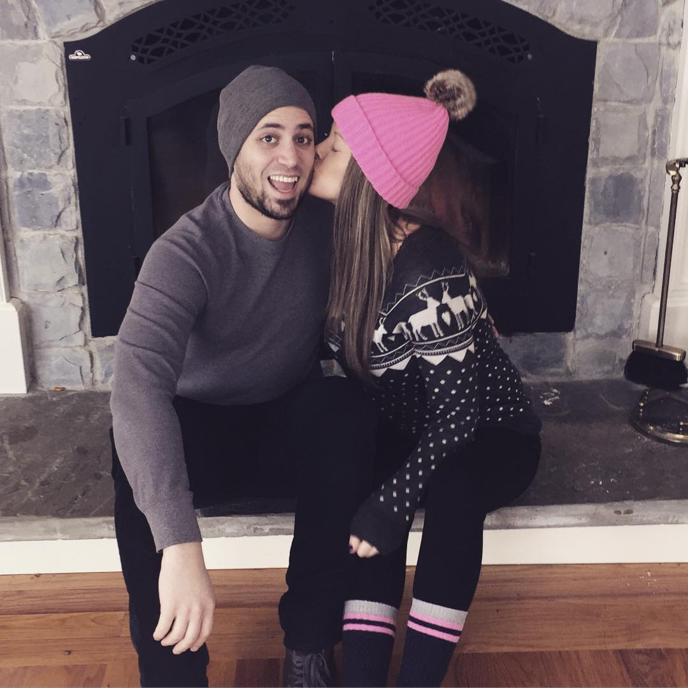

All time favorite pasta. This is indulgent - you just gotta go with it. Butter? Yes. Heavy cream?

You heard that right. Whole box of pasta? A-duh! It’s cozy and comforting - perfect for a Sunday night, snuggled in with your babyhead named Steve!

## Ingredients

- 4 links hot italian sausage, casing removed
- 1 small onion, finely diced
- 4 cloves of garlic, minced
- 1 tablespoon tomato paste
- 1 28 oz. can crushed tomatoes (or plum tomatoes, broken up with your hand - San Marzano is best)
- Heavy cream (eyeball - maybe ½ cup)
- ½ cup good quality pecorino romano cheese (plus more for serving)
- 1 container of button mushrooms, sliced
- Fresh peas, blanched (or you can use frozen) - about ¾ a cup
- Dried or fresh basil and oregano
- 1 cup of vodka
- 1 box of rigatoni (rotini or penne works too)
- 2 tablespoons butter

## Instructions

- In a sturdy pot (I use my dutch oven), cook sausage with 1 tablespoon butter and break it up until finely ground. Set aside. In the same pot, add mushrooms with another tablespoon of butter and sauteé. Set aside.
- Add the onion and garlic to the same pot and sautee at medium low heat until the onions are soft and cooked through, making sure not to burn the garlic.
- Add the vodka and turn up the heat - boil/reduce by half.
- Add the tomato paste and stir. Add the can of tomatoes, basil and oregano (if using dried), salt and pepper. If using fresh herbs, wait until the end to add. Do not taste-test at this point - the vodka needs time to cook out. Simmer at medium-low for 1 hour, being careful to check on it and stir it to make sure it's not burning. You want this to reduce so it’s more thick and jammy and less liquidy.
- Boil the pasta in salted water and cook until al dente.
- Once the sauce has reduced and thickened, add the mushrooms, peas, and meat.
- Add in the heavy cream to rehydrate the sauce and stir (eyeball until it’s the right pink color and consistency) - then add the pecorino and cooked pasta. (yes, to the sauce - it’s necessary to finish cooking in the sauce and to incorporate the sauce into all the ridges) Add any fresh herbs, if using fresh. Keep the heat low and stir everything together.
- Serve with crusty bread, a bottle of red wine, and more cheese for topping!
