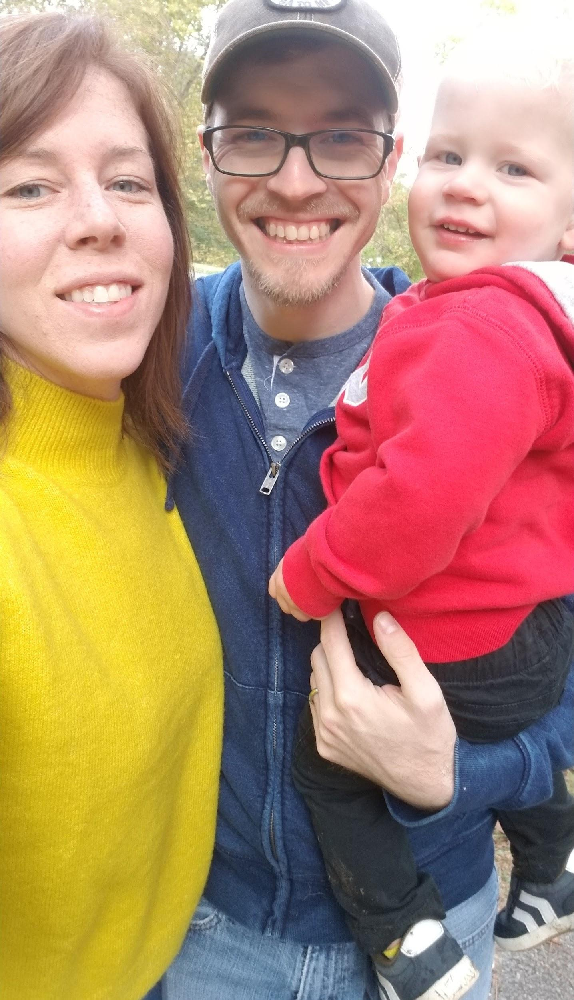
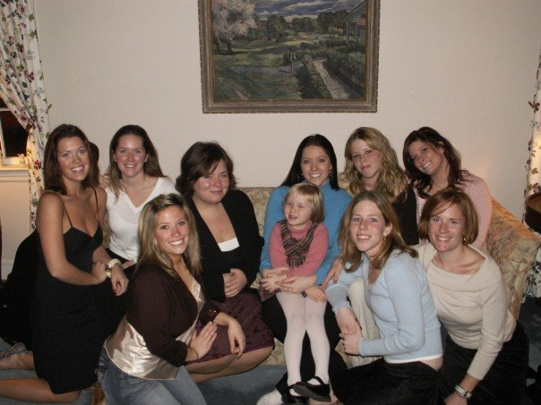

I love entertaining at brunch! It’s so easy, the dishes are cheap, and you have all day to linger and catch up. This is a super versatile dish - you can substitute andouille sausage and cajun seasoning for a creole version, or spicy Italian sausage and basil for an Italian version. Since my best sis Ali loves Mexican food for breakfast, I cook this for her.

## Ingredients

- 1 lb. Chorizo
- 16 oz. Black beans (canned are fine)
- 1 sweet potato
- 1 bell pepper
- 1 red onion
- Garlic
- Canola oil
- Cumin
- Smoked paprika
- Chili powder
- Shredded mexican or cheddar cheese
- 6 eggs
- Cilantro or parsley
- Optional: Tortillas, sour cream, hot sauce

## Instructions

- Crumble the chorizo into an oven-safe skillet heated to medium-high.
- Preheat the oven to 400°.
- Dice the sweet potato, onion and bell pepper, chop the garlic.
- Once the chorizo is browned remove from skillet and if the pan is dry, add a little oil.
- Bring back up to medium and add the sweet potato, onions and peppers - cook until the onions are translucent and the potatoes soft.
- Add the garlic stirring until fragrant.
- Rinse and drain the black beans and add to the skillet.
- Add cumin, paprika and chili powder to taste; add salt and pepper.
- Add back in the chorizo and stir.
- Crack 6 eggs around the pan on the top; Cook until egg whites are solid.
- Remove pan and sprinkle cheese on top; Add back to oven until cheese is melted.
- Remove from oven and sprinkle with cilantro or parsley.
- Optional to serve with tortillas, sour cream and hot sauce.
