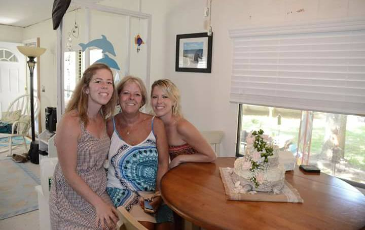

Crab, cheese, and bread - what’s there not to like?

## Ingredients

- 1 c Hellman’s regular mayonnaise
- 1 c grated parmesan cheese
- ½ lb crab meat
- 1 jar marinated artichoke hearts; chopped
- 1 tbsp Worcestershire sauce
- 1 sourdough bread bowl; hollowed

## Instructions

- Mix ingredients together in a medium bowl.
- Transfer to bread bowl or baking dish.
- Bake at 350° for 30 minutes, or until hot and bubbly. Serve with bread from bowl and crackers.
