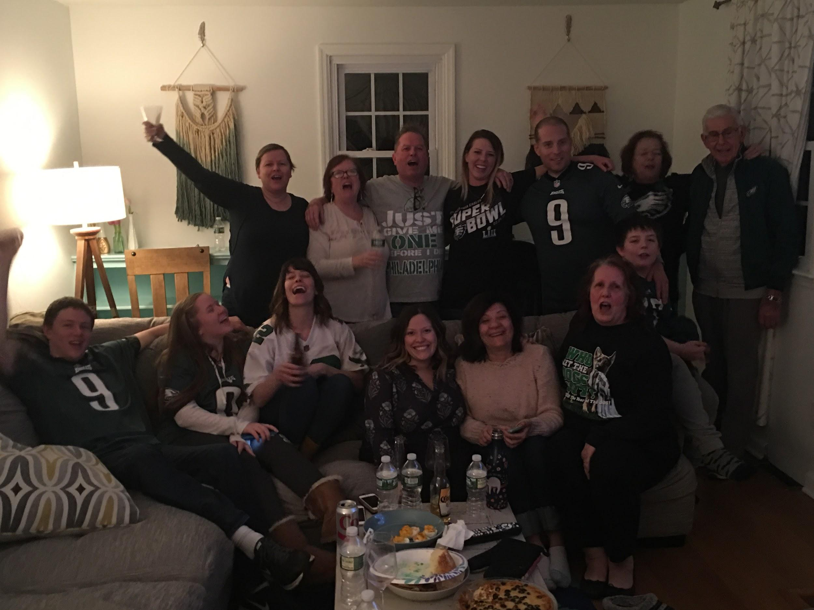

The Philadelphia Eagles PHI-NALLY won a Super Bowl in 2018. Our Eagles-loving family of course had to get together for the game and there was SO MUCH food. MVP goes to Sean Vernon both for how many wings he supplied and his reaction.

## Ingredients

- 1,000 delicious wings

## Instructions

- Ask the party host how many people are attending.
- Assume each guest will have roughly 55 wings.
- Buy the most delicious wings!
- Panic as you realize you bought sooo many wings, tell everyone at the party they freeze well.
- For years to come, whenever someone asks what you’re bringing to the party say “a million chicken wings!”
