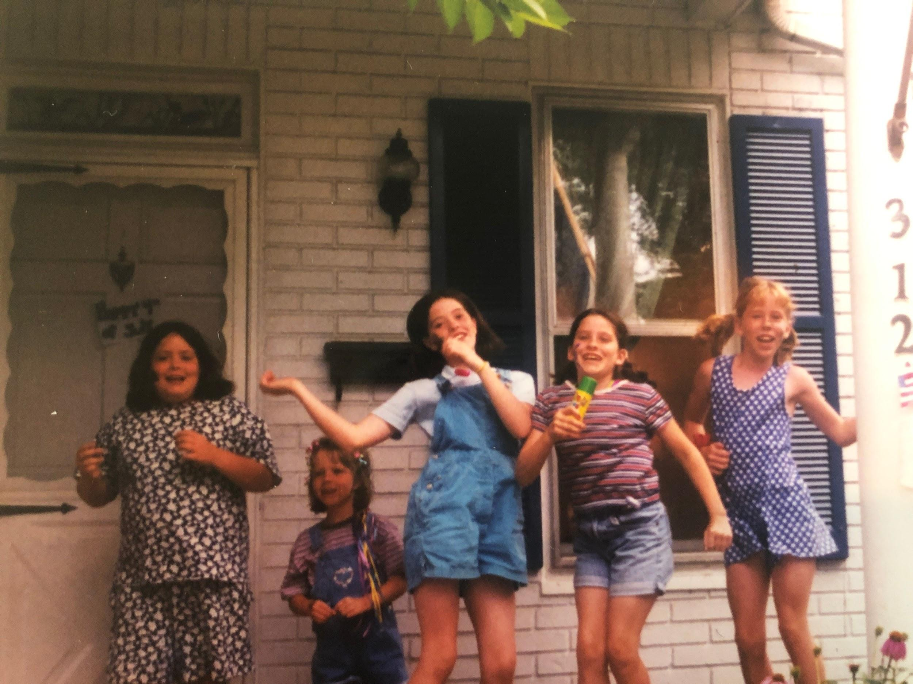

This dip is best served surrounded by hungry Hoban cousins at a summer party. Make a separate portion for the grownups if you want a chance at eating it, we WILL bite you.

## Ingredients

- Cream cheese
- 15 oz can of Hormel chili with beans
- Shredded cheddar or Mexican cheese
- Sour cream
- Tortilla chips
- Optional - canned green chilies
- Optional - scallions

## Instructions

- Place the cream cheese in a round shallow microwaveable dish.
- Microwave for about 30 seconds until soft.
- Spread around so it covers bottom of dish.
- Spread the chili around on top of the cream cheese.
- Microwave for about 30 seconds.
- Sprinkle the cheese on top (If adding canned chilies, add with the cheese).
- Microwave for 30 seconds until cheese is melted.
- Remove from microwave and add dollops of sour cream to the top.
- If adding chopped scallions, sprinkle on top.
- Serve with tortilla chips.
