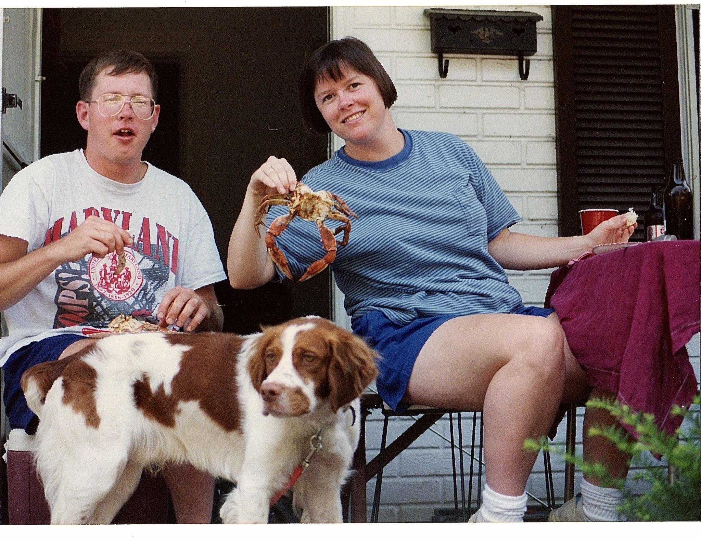

It’s not a beach vacation without watching the massacre of dozens of crabs at the hands of Uncle Chris Ragan. This is messy business, and typically requires a garden hose, several horrified onlookers, and Uncle Joe as co-pilot. Beware of rogue crabs, who have been known on more than one occasion to chase after Uncle Chris with a knife!

## Ingredients/Equipment

- 1 Bushel Maryland blue crabs
- Large steamer pot
- Water and beer for steamer (ask the pro for ratios here!)
- Old Bay (bonus points if you use the homemade blend that the crabbers sell)
- Mallets, crackers, paper towels, newspapers, a picnic table, crisp wine or a cold beer, and good company - you’ll be sitting for hours enjoying these!

## Instructions

- For cleaning crabs: ○ Start an assembly line: Tongs/knife, a trash can, a hose for rinsing, and a tray for the cleaned crabs. ○ Pull the “tab” off the back of the crab, remove the shell and innards, and rinse out the gunk. ○ Repeat. Try not to get pinched or stabbed! ○ Save a few crabs to keep “whole” for the family members who like their crabs the old fashioned way, with a little “mustard.”
- For steaming crabs: ○ Add water and beer to the steamer pot. ○ Once boiling, add the cleaned crabs into the steamer basket, layering with Old Bay as you go. You want the seasoning to get into all the nooks and crannies - don’t be shy! ○ Steam for ~20 minutes, or as Tom Fongemie would say “for as long as it takes to drink two beers!” ○ Serve piping hot, piled high on top of newspapers, with extra butter for dipping!
