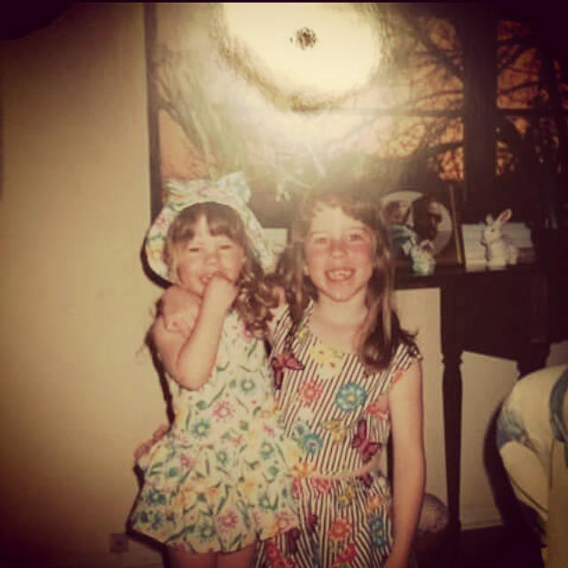

Anyone who has visited our Dad can attest to this “dish.”

He also likes to offer you his first bite at a restaurant- before he has even tried it himself! When he is expecting visitors, he likes to play it cool. Everything is very “laid back” when you are coming for a visit…or is it?

## Ingredients

- Everything your visiting guest has ever liked, mentioned liking, or you think they might like - ever.

## Instructions

- A month or two before your guest arrives, brainstorm what kinds of foods they like. Were they drinking a flavored club soda last time you saw them? Did they once say Turkey was their favorite Thanksgiving dish? Note it, and every time you are at any store, pick these items up.
- Fill every candy dish in the house.
- Load the freezer with various flavors of ice cream.
- Have 1-2 bottles of every kind of drink you plan to offer (get a lot at the dollar store).
- When guests arrive, pretend like you didn’t do any of this. Ask if they want a drink. When they say, “I’m ok right now,” follow up by listing off all 27 flavors of drinks you have until they cave and take something.
- Ask what they want to eat because you “might have a few things.” While they ponder (or even after they give you an answer) continue to list every single thing you have to eat in the kitchen. (Includes fully baked turkey, olives, pickles, sliced american cheese, etc.)
- Show them how much you love them!
