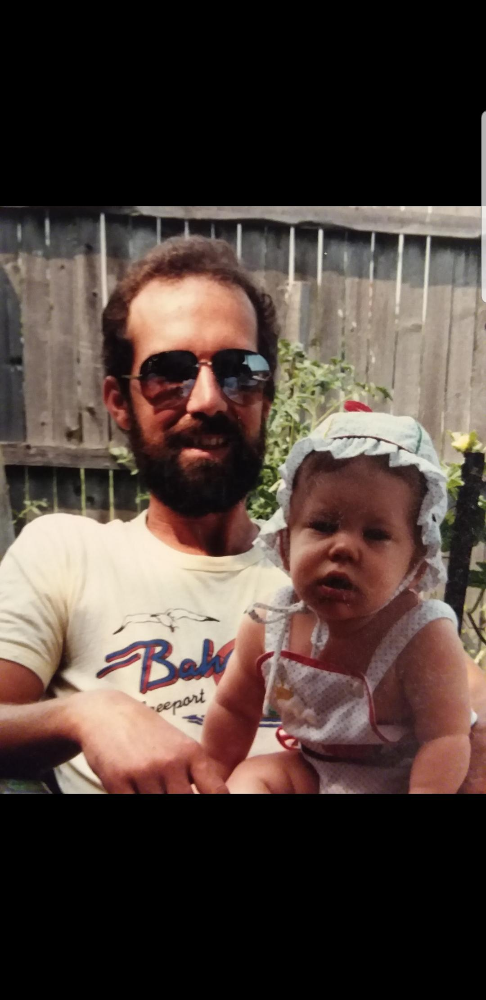

Dad makes these pancakes on a regular Sunday or when he secretly know that his kids are having a tough day. To be passed down to the next generation!

## Ingredients

- Boxed pancake mix (follow instructions)

## Instructions

- Create one large pancake with two little circles (In the shape of Mickey Mouse).
- Give them to your kids and make them feel special!
- Act like it’s no big deal (similar to Uncle Joe’s response of “okay” when you compliment his food).
